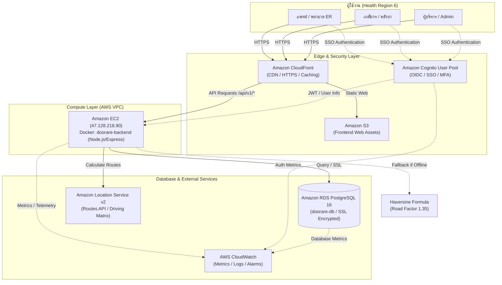

# Architecture

## Deployed AWS Production Stack (DooRare)

- **Frontend:** React + Vite SPA, hosted on S3 and served via CloudFront CDN (`https://d27x5bphqn4glk.cloudfront.net`).
- **Auth:** AWS Cognito User Pool (`us-east-1_Yqc7bshFl`) with OIDC authorization code flow.
- **Backend:** Node.js Express REST API on EC2 container, handling business logic, borrow ladders, and forecasts.
- **Database:** AWS RDS PostgreSQL 16 (`doorare-db`) with SSL TLS enforcement (`rejectUnauthorized: false`).
- **Routing:** Amazon Location Service v2 Routes API with automated Haversine fallback (1.35 tortuosity factor).
- **Monitoring:** AWS CloudWatch tracking EC2, RDS, and Cognito User Pool events.
