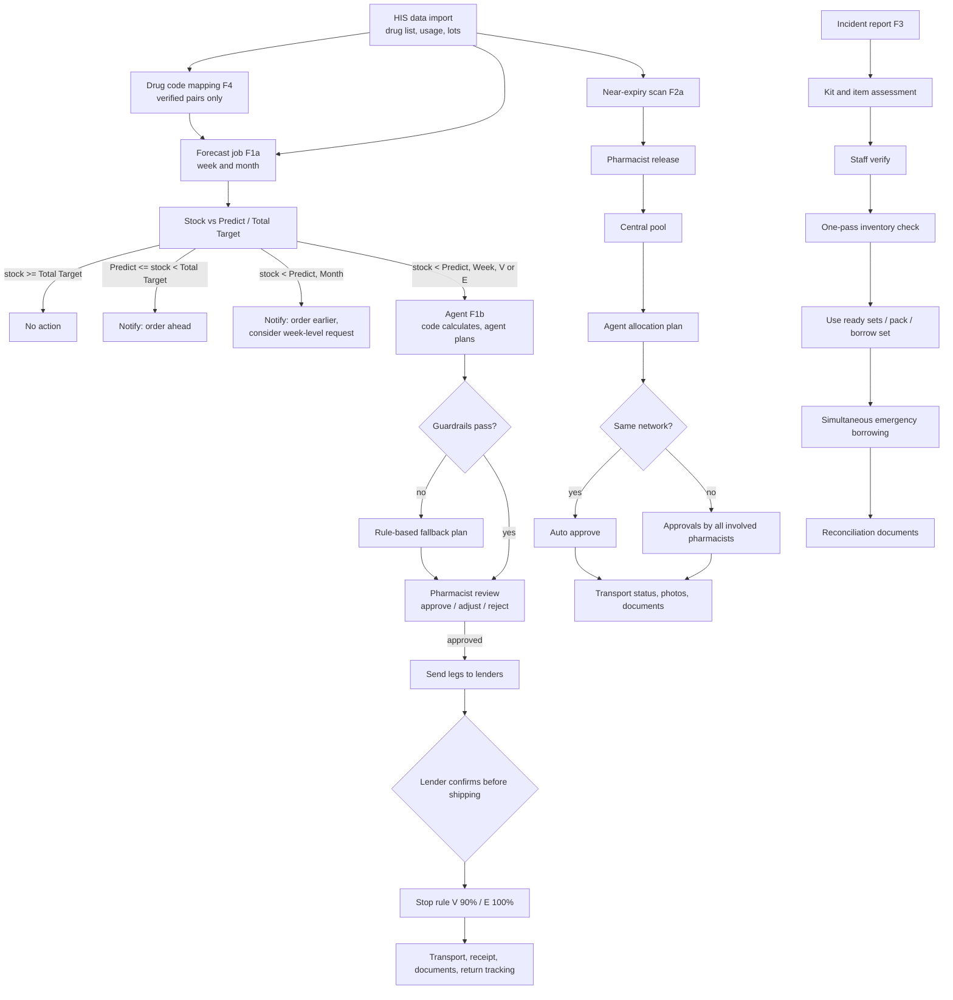

# Full Development Specification for DooRare

**Doo Rare (ดูแร์)** — Hospital medicine & medical-supply stock forecasting, inter-hospital borrowing, near-expiry redistribution, and emergency (mass-casualty) preparation on AWS.

| Item | Value |
|---|---|
| Spec version | 1.3 (2026-10-13) — rev 1.3: the สปสช. 24-digit code is removed everywhere (TMT is the only standard drug code; ASM-48); catalogue items have a type DRUG / SUPPLY / BLOOD, and non-drug supplies use an admin-maintained central list instead of TMT (ASM-48); F4 is stated as a sub-feature of Feature 2 (source F2 §6); rev 1.2: usage-history retention 10 years (ASM-26/41); blood handling — F3 may borrow **PRC group O only** in emergency context (ASM-47, BR-F3-031), all other blood products are reminder-only (BR-F3-032), blood excluded from F1/F2 (BR-F1a-024, BR-F2a-031), blood return by replacement via blood bank (BR-XC-013); rev 1.1: return in kind only (ASM-24); F-09 quantile buffer for intermittent demand (ASM-43); F3 real-time ETA, no speed table (ASM-19); driver = hospital staff + offline sync (ASM-44); pack size per hospital (ASM-45, F-32); F3 small model (ASM-46); role history (SEC-015) |
| Source document | "Feature 1–3 requirement document" v8, 17 pages (Thai). Feature 1 = Stock forecast & auto-procurement, Feature 2 = Near-expiry management (incl. Drug Code Normalization §6), Feature 3 = Emergency preparedness |
| Output language | English with Thai domain terms preserved, English translation in parentheses where useful |
| Deployment target | AWS (region `ap-southeast-7` Bangkok if available for all services used, otherwise `ap-southeast-1`; see §19 and ASM-31) |
| Timezone / currency / locale | `Asia/Bangkok` (UTC+7) / THB / Thai + English, Buddhist-calendar display optional, stored in UTC |
| Audience | Developers **and** AI coding agents (vibe coding). Every rule is ID-tagged so an agent can be told "implement BR-F1-014 and FR-F1-020 only". |

## How to use this specification (read this first)

1. **Machine-readable contracts win over prose.** If prose and a contract file disagree, the contract is the source of truth: `schema.sql` (database), `openapi.yaml` (API), `agent-tool-schemas.json` (agent tools and output), `seed-data.json` (sample data), `config-defaults.yaml` (all configurable values). Fix the prose afterwards and log the discrepancy.
2. **Numbers are computed by code, never by the LLM.** Sections 8–9 define every formula; implement them as pure functions in `apps/api/doorare/domain/formulas` with unit tests (§25) before building any agent or UI.
3. **Markers used throughout**
   - `ASSUMPTION:` (ID `ASM-xx`) – I filled a gap in the source document. Build it as a configurable default.
   - `OPEN QUESTION:` (ID `Q-xx`) – needs a business owner decision. Build the default stated beside it.
   - `RISK:` (ID `R-xx`) – technical, operational, legal or data risk.
   - Items the source marks **(ข้อเสนอ) "proposal"** are treated as *configurable business rules with the stated default* (see §23), exactly as instructed.
4. **Requirement ID scheme**

| Prefix | Meaning | Example |
|---|---|---|
| `FR-<feature>-nnn` | Functional requirement | `FR-F1-004` |
| `BR-<feature>-nnn` | Business rule | `BR-F2-014` |
| `AGT-<feature>-nnn` | Agent behaviour/guardrail | `AGT-F1-003` |
| `API-nnn`, `DB-nnn`, `UI-nnn`, `JOB-nnn`, `CFG-nnn`, `NFR-nnn`, `SEC-nnn`, `TST-nnn`, `T-nnn` | API, DB, UI, job, config, non-functional, security, test, backlog task | `API-031` |

   Feature codes: **F1a** Forecast & Alerts, **F1b** Borrow Orchestration, **F2a** Near-expiry Release & Allocation, **F2b** Repeated-expiry Detection, **F3** Emergency Preparedness, **F4** Drug Code Normalization (a sub-feature of Feature 2, source F2 §6 — separated only because F1–F3 all depend on its Verified mappings), **XC** cross-cutting (documents & returns, manual request, auto-approve, context agent, value dashboard, audit).
5. **Suggested build order for agents:** `apps/api/doorare/domain/formulas` → `schema.sql` + migrations → master data & mapping (F4) → inventory & usage ingestion → F1a → F1b (rule-based fallback first, agent second) → F2 → F3 → reporting → hardening. Details in §27–28.

---

## 0. Completeness Checklist

Result of checking the source document against the required areas.

| # | Area | Covered in source? | Evidence / gap |
|---|---|---|---|
| 1 | Business overview | **Partial** | Per-feature overview paragraphs exist (F1 §1, F2 §1, F3 §1). No stakeholder list, volumes, or success targets. |
| 2 | User roles | **Partial** | Implied only: เภสัชกร (pharmacist), เจ้าหน้าที่ (officer), เจ้าหน้าที่ขับรถขนส่ง (driver), admin, เจ้าหน้าที่ห้องฉุกเฉิน, ทีมผู้ดูแลข้อมูลยา. No permission model. |
| 3 | Feature list | **Yes** | F1 (11 sections), F2 (7 sections), F3 (9 sections). |
| 4 | Business rules | **Yes (F1) / Partial (F2, F3)** | F1 has thresholds. F2 lacks numeric near-expiry threshold, transport-cost threshold, plan approval timeout. F3 lacks kit contents and triage rules. |
| 5 | Formulas | **Yes (F1) / Partial (F3) / No (F2)** | F1: need, Si, Window_max, LendableStock, Safety Stock, Total Target. F2: only descriptive ("remaining life > transit + consumption time"). F3: ETA fallback, Estimated vs Critical Minimum, kit spreading described in words. |
| 6 | Approval flows | **Yes** | F1 §8, F2 §2.2/2.6/4, F3 §3.5/5.1. |
| 7 | Agent behaviour | **Yes (F1) / Partial (F2, F3)** | F1 §4 has 6 tasks, tools, guardrails, fallback, kill switch, worked example. F2 §2.4 and F3 §3.1 describe planning only. |
| 8 | Data entities | **Partial** | Only data lists (F1 §11, F2 §6.1 table, F3 kit/items). No schema. |
| 9 | External integrations | **Partial** | HIS (F2 §6.1), TMT, route-calculation service (F3 §6 names Amazon Location Service). PO system implied. Distance table pre-stored (F1 §6.1). |
| 10 | Reports / dashboard | **Partial** | Daily summary (F1 §4.1-6), Value metric (F1 §11), model metrics (pinball loss, coverage, stock-out rate), reconciliation documents (F3 §7). |
| 11 | Edge cases | **Partial** | Some (all rejected, nobody in time, partial delivery, controlled drugs, cold chain). Many not stated; added in §7 per feature. |
| 12 | Security | **No** | Only "admin sees all hospitals; each hospital sees only its own" (F1 §11) and "human approves everything". Everything else is specified here as assumptions (§18). |
| 13 | Testing needs | **Partial** | Model evaluation only. Test strategy specified in §25. |

### Missing Information / Assumptions (summary — full lists in §3)

Missing and therefore assumed: role model (ASM-01), network/region model (ASM-02), schedules (ASM-03), units and rounding (ASM-04), σ definition (ASM-05), pattern-classification precedence and cold-start (ASM-08/09), approval ladder semantics (ASM-10/11), stock-movement points (ASM-13), near-expiry/transport/repeat-expiry numbers (ASM-14..16), mapping confidence (ASM-17), kit recipes and triage rules (ASM-18), ETA speed table (ASM-19), security and retention (ASM-26/27), AWS service choices (ASM-21/31). **Three research topics that were requested after v8 (kit contents, cold-chain limits, TMT code structure) were not completed; all numbers that depend on them are explicit assumptions and flagged for validation by a pharmacist.**

---

## 1. Executive Summary

**What the system does.** Doo Rare connects the pharmacies and emergency rooms of public hospitals in a health region so that (1) drug stock is *forecast* and shortages are caught early and covered by purchasing or borrowing; (2) drugs that are about to expire in one hospital are *redistributed* to hospitals that will use them in time; (3) when a mass-casualty incident (MCI) is reported, the right medical supplies are *prepared and borrowed within minutes*; and (4) drug codes from different hospital systems are *normalised* so that "the same drug" can be matched across hospitals.

**Who uses it.** Hospital pharmacists (approve/decide), procurement and warehouse officers (operate), ER staff (incident handling), transport staff/drivers (delivery status and photos), data admins (code mapping), hospital/region/system admins (configuration, oversight), and auditors (read-only).

**Main business problems.**

| Problem | Today | Doo Rare answer |
|---|---|---|
| Stock-outs of vital drugs | Pharmacists estimate by experience; borrowing by phone | F1: forecast + P95/P90 targets + ranked, approved borrowing in hours |
| Expired drugs (waste) and overstock | Each hospital absorbs losses alone; slow manual redistribution | F2: release to a regional pool, matched allocation, repeat-expiry detection |
| MCI supply scramble | Staff list items by hand in minutes | F3: preset kits per patient, one-pass inventory check, simultaneous emergency borrowing |
| Inconsistent drug codes | Local codes differ per hospital | F4 (sub-feature of F2): TMT mapping for drugs, central list for non-drug supplies, with verification |

**Main value.** Fewer stock-outs and fewer expired drugs, measured by a value dashboard (THB saved, under/overstock reduction), shorter time from shortage to confirmed supply, and faster emergency preparation.

**Major modules.** Forecast & Alerts (F1a) · Borrow Orchestration with Agent (F1b) · Near-expiry Release & Allocation (F2a) · Repeated-expiry Detection (F2b) · Emergency Preparedness (F3) · Drug Code Normalization (F4, sub-feature of F2) · Cross-cutting: transfer/return documents, manual requests, auto-approve within a network, Context Agent, value dashboard, audit.

**Major technical challenges.**

1. Forecast quality for lumpy/intermittent vital drugs and cold-start items (< 3 months of history) → quantile models, honest coverage metrics, conservative defaults.
2. Keeping an LLM agent useful but *safe*: deterministic calculation, strict JSON schema, guardrail engine, rule-based fallback, human approval before anything leaves the hospital.
3. Concurrency and correctness of multi-hospital stock reservations (no double-lending, no lost updates).
4. Data quality: HIS exports with missing lot/expiry data, inconsistent units, local-code chaos.
5. Latency in emergencies: F3 timeouts are minutes, so the F3 path must not depend on slow or fragile components (LLM optional, rule-based plan always available).
6. Strict multi-tenant data isolation with region-level and system-level oversight.

---

## 2. Glossary

| Term (EN) | Thai | Definition in this system |
|---|---|---|
| Hospital | โรงพยาบาล (รพ.) | A tenant. Belongs to one health region and optionally one hospital network. |
| Health region | เขตสุขภาพ | Administrative grouping of hospitals (13 regions in Thailand). Scope of the central near-expiry pool and default lender search. |
| Hospital network | เครือข่ายโรงพยาบาล / เครือเดียวกัน | Group of hospitals under one owner/arrangement. Hospitals in the same network may use Auto Approve for near-expiry requests (F2 §4). |
| Pharmacist | เภสัชกร | Primary approver for drug-related actions. |
| Officer | เจ้าหน้าที่ | Operational staff (procurement, warehouse, ER). |
| Drug / item | ยา / เวชภัณฑ์ | Any drug or medical supply managed in stock. |
| Stock | สต็อก | Sum of **usable** lot quantities at a hospital (excludes expired, held, and — by proposal — lots near expiry). |
| Lot | ล็อต | Batch with lot number and expiry date (วันหมดอายุ). Stock is tracked per lot. |
| Usage (daily usage) | ยอดใช้ | Quantity dispensed/consumed per day, imported from HIS. |
| Predict | ค่าทำนาย | Forecast P50 (median) usage for a period. |
| P50 / P90 / P95 | – | Forecast quantiles. |
| Total Target | ระดับเป้าหมายรวม | Predict + variability buffer (V: P95, E: P90). Level the hospital should hold; also the lender's keep-level. |
| Safety Stock | ส่วนเผื่อ | `Z × σ × √L` for REGULAR demand only; for INTERMITTENT demand the quantile-model buffer (V P95, E P90) replaces it (F-09 B). |
| Lead time (L) | ระยะเวลารอของ | Days until a new lot arrives (open PO ETA, else standard lead time). |
| σ | ส่วนเบี่ยงเบนมาตรฐาน | Standard deviation of daily usage. |
| Z | ระดับความระวัง | V = 1.65, E = 1.28. |
| VED | VED | Vital (จำเป็นต่อชีวิต) / Essential (สำคัญปานกลาง) / Desirable (จำเป็นน้อย), assigned **per item per hospital**, not per disease group. |
| ABC | ABC | Value class = usage × unit price; used only for ordering checks/alerts (V-A first). |
| Demand pattern | รูปแบบการใช้ยา | Steady / spiky-seasonal-expensive-rare / non-forecast cheap. Selects the forecast method. |
| Moving Average / Exponential Smoothing | – | Method for steady demand. |
| Quantile forecasting | – | Model that outputs P50/P90/P95 directly. |
| Min-Max | – | Simple reorder rule (e.g., below 10 boxes → refill to 50). For D items; never enters the borrow Agent. |
| Rolling backtest | – | Weekly re-forecasting on history to obtain residuals and evaluate metrics. |
| Window_max | – | `stock ÷ daily usage` — time until the requester runs out. |
| Ttransit | เวลาเดินทาง | Pre-stored travel time between hospitals (excludes picking/packing time). |
| LendableStock | สต็อกที่ให้ยืมได้ | `max(0, CurrentStock − TotalTarget)` of the lender. |
| Hard Filter | – | Mandatory eligibility checks for a lender before scoring. |
| Hospital Priority Score (Si) | คะแนนความเหมาะสม | `w1·ScoreTime + w2·ScoreFulfill + w3·ScoreStockSafety + w4·ScoreRouteReliability`. |
| ApprovalRate / AvgTimeoutRate | – | Lender reliability inputs from request history. |
| Urgency level | ระดับความเร่งด่วน | Normal (ปกติ) / Urgent (เร่งด่วน) / Very urgent (เร่งด่วนมาก). |
| Borrow request | คำขอยืม | Request from a hospital for a drug quantity; composed of items and per-lender legs. |
| Leg | – | One request to one lender hospital within one round. |
| Round | – | One batch of legs sent together; next round asks the next hospitals. |
| Timeout | – | Max wait for a lender response; silence = rejection. |
| Human-in-the-loop (HITL) | เจ้าหน้าที่เป็นผู้อนุมัติ | Staff approval before any stock-moving or external action. |
| Agent | เอเจนต์ | LLM-based planner that recommends/ranks/explains; calls deterministic tools. |
| Context Agent | – | Agent that collects external context (outbreaks, seasons, events, abnormal demand) to help judge urgency. |
| Guardrail engine | – | Deterministic validator for agent output. |
| Fallback | แผนสำรอง | Rule-based plan used when the agent fails; decision source `FALLBACK`. |
| Kill switch | ปิดโหมด Agent | Admin toggle that disables the agent; system continues with rule-based plans and manual requests. |
| Near-expiry | ใกล้หมดอายุ | Remaining shelf life ≤ per-drug threshold (default 180 days). |
| Central near-expiry pool | คลังข้อมูลยาใกล้หมดอายุส่วนกลาง | Region-wide data pool of released lots. Goods stay physically at origin. |
| Reserved / held (ถูกกันไว้) | ถูกกันไว้ | Status of released lot quantity excluded from usable stock and lendable stock. |
| Allocation plan | แผนจับคู่และจัดสรร | Agent/officer plan assigning lot quantities to receiving hospitals. |
| Repeated expiry | หมดอายุซ้ำ | Same drug (GPU) at same hospital expiring/released in ≥2 lots within 12 months. |
| Transfer / borrow-return document | เอกสารยืม-คืน/โอนย้าย | Printable document with numbers, lots, expiry, delivery method, return terms and signatures. |
| Cold chain | การควบคุมอุณหภูมิ | Drugs needing refrigerated transport (vaccines, insulin, biologics). Flag in drug data. |
| Controlled drug | ยาควบคุมพิเศษ | Narcotics/psychotropics — excluded from automation, manual regulated flow only. |
| Local code | รหัสท้องถิ่น | Hospital's own drug code in HIS. |
| TMT | รหัส TMT | Thai Medicines Terminology. Levels used: GPU/TPU (substance, strength, dosage form[, trade]) and GPP/TPP (package). |
| GP / GPU | รหัส GP | Generic product (use) key; canonical grouping key for "same drug" (OPEN QUESTION Q-22). |
| Central list | รายการกลางเวชภัณฑ์ | Admin-maintained list of non-drug supplies (and blood) that have no TMT code; hospitals pick from it when importing; each item has a system `internal_code`. **ASM-48** |
| Item type | ชนิดรายการ | `DRUG` (medicine, TMT GP), `SUPPLY` (non-drug medical supply, central list), `BLOOD` (blood component, F3 only). **ASM-48** |
| Mapping confidence | ค่าคะแนนความมั่นใจ | 0–1 score of a suggested mapping. |
| Verified mapping | คู่รหัสที่ยืนยันแล้ว | Pharmacist/data admin-confirmed local code ↔ TMT pair (drugs) or ↔ central-list item (supplies); only these are used by agents. |
| Incident (MCI) | เหตุการณ์ฉุกเฉิน / เหตุหมู่ | Event with many casualties arriving at the ER. |
| Triage level | ระดับความรุนแรง | Red (วิกฤต) / Yellow (เร่งด่วน) / Green (ไม่รุนแรง). **ASM-18** |
| ETA | เวลาที่ผู้บาดเจ็บจะมาถึง | Expected arrival time of casualties. |
| Preset Kit | เซ็ตสำเร็จรูป | Pre-packed set for **one patient** (Trauma Set, Intubation Set, IV Set, Burn Kit). |
| Additional items | สิ่งของนอกเซ็ต | Items needed outside kits (e.g., chest tube, splints, TXA). |
| Estimated | จำนวนประเมิน | Quantity needed counting patients of **all** triage levels. |
| Critical Minimum | จำนวนขั้นต่ำวิกฤต | Quantity needed counting **critical** patients only. |
| Buffer (emergency) | ตัวเลขสำรอง | `Estimated − Critical Minimum`. |
| Spread items (BOM explosion) | กระจายไอเทม | Expanding kit counts into component items by kit recipe, for calculation only (never unpacks real sets). |
| Post-Incident Reconciliation | การเคลียร์ยอดหลังเหตุการณ์ | Summarise borrowed items, track returns, issue borrow/return and usage summary documents. |
| พ.ร.บ. / UCEP | พ.ร.บ. / สิทธิ UCEP | Compulsory motor insurance / Urgent-care emergency patient entitlement; the usage summary is supporting data for the treating hospital's claim. |
| 1669 | 1669 | National emergency medical dispatch centre; decides which hospital receives casualties (out of scope). |
| HIS | HIS | Hospital Information System. |
| GPO | องค์การเภสัชกรรม | Government Pharmaceutical Organization; supplier/VMI context. |
| DMSIC | – | MOPH Drug and Medical Supply Information Center; reference price source. |

---

## 3. Assumptions, Open Questions, and Risks

### 3.1 Assumptions

Each assumption is a **configurable default** unless marked "structural". Config keys are in §23.

| ID | Assumption | Why needed |
|---|---|---|
| ASM-01 | Roles: `SYSTEM_ADMIN`, `REGION_ADMIN`, `HOSPITAL_ADMIN`, `PHARMACIST`, `PROCUREMENT_OFFICER`, `WAREHOUSE_OFFICER`, `ER_STAFF`, `DRIVER`, `DATA_ADMIN`, `AUDITOR`. "เจ้าหน้าที่ผู้อนุมัติ" in F1 = `PHARMACIST` (F1 §4.4 step 3: "เภสัชกรอนุมัติ"); in F3 = `ER_STAFF`. | Source names no roles. |
| ASM-02 (structural) | A hospital belongs to exactly one health region and at most one hospital network. "Same network" = same `hospital_network_id`. | Needed for pool visibility and auto-approve. |
| ASM-03 | Schedules (Asia/Bangkok): usage ingestion nightly 01:00; weekly forecast Mondays 02:00; monthly forecast day 1 03:00; stock-alert evaluation nightly 04:00 and on demand after inventory changes; near-expiry scan nightly 05:00. | Source gives week/month granularity but no schedule. |
| ASM-04 (structural) | All quantities are integers in the drug's **base dispensing unit** (tablet, ampoule, vial, bag, jar). Package sizes are conversion data. Lending quantities are rounded **up** to whole base units; if `drug.lend_in_packs = true` they are rounded up to a multiple of `pack_size`. | Avoid fractional vials. |
| ASM-05 | σ = sample standard deviation of **daily** usage over the trailing 90 days (minimum 28 days), counting days with no record as 0. | Source says "calculated from usage history" only. |
| ASM-06 | LendableStock uses the lender's Total Target of the **weekly** granularity (nearest future week) when the requester alert is weekly. | Source does not state the horizon. |
| ASM-07 | Residual quantiles for MA/ES come from an expanding-window weekly rolling backtest; residual = `max(0, actual − forecast)` tail; at least 26 residuals required, otherwise fall back to normal approximation `Z × residual_std`. | Source says "from residuals of rolling backtest". |
| ASM-08 | Cold-start (< 90 days of history): use a **global pooled quantile model** trained on all items of the same VED class, flagged `LOW_CONFIDENCE` in UI. | Source mandates Quantile for < 3 months but a per-item model is not trainable. |
| ASM-09 | The method router never assigns Min-Max to VED = V or E items (it falls back to MA/ES or Quantile) unless a DATA_ADMIN override with a reason exists. | Source: Min-Max items never enter the borrow Agent, but V/E must. |
| ASM-10 | The approved plan contains an **ordered ladder** of lender hospitals with maximum quantities. Later rounds proceed automatically down the *approved* ladder (recomputing remaining quantity and applying stop rules). Adding a hospital outside the ladder or raising quantity requires a new approval. | Source: step 5 "ask next hospital in next round" vs "send only after officer approves". |
| ASM-11 | The approver may lower any quantity freely. Raising above the calculated quantity requires PHARMACIST role, a reason, is capped by lender usable stock, and is logged `OVERRIDE`. | Source only says approve/adjust/reject. |
| ASM-12 | Lot quantity released to the central pool is `held` — excluded from usable stock, from F1 lendable stock, and from local dispensing recommendations; the origin pharmacist may withdraw it before the goods are loaded. | Source: pool lots have status "ถูกกันไว้" while goods stay at origin. |
| ASM-13 (structural) | Physical stock moves only on **officer confirmations**: lender stock decreases when the transport record becomes `LOADED`; borrower stock increases when the receiving officer confirms receipt after `ARRIVED`. For emergency kit packing, stock changes when the officer confirms packing (F3 §4.3). | HITL for inventory changes. |
| ASM-14 | Near-expiry default threshold = **180 days** remaining, overridable per drug by the pharmacist. | Source: "per drug, set by pharmacist". |
| ASM-15 | Transport economics: uneconomical when `transport_cost ≥ 0.20 × lot_value_allocated`. Cost model (default): `300 THB + 8 THB/km × distance_km + 500 THB cold-chain surcharge`. Unverified numbers. | Source gives no rule. |
| ASM-16 | Plan approval timeout (F2): 48 h, reminder at 50 %. After timeout the plan becomes `NEEDS_DISCUSSION`. | Source silent. |
| ASM-17 | Mapping confidence = 0.40·name + 0.30·strength + 0.20·dosage form + 0.10·package/unit similarity; a strength mismatch caps the score at 0.40. `≥ 0.85` → `SUGGESTED`; `0.60–0.85` → `LOW_CONFIDENCE`; `< 0.60` → `UNMAPPED`. All pairs require human verification before agent use. | Source names the score, not its definition. |
| ASM-18 | Triage levels: `RED`, `YELLOW`, `GREEN`. Kit recipes (BOM), kit-per-patient and extra-item-per-patient rules are **seed placeholders** owned by a clinical owner (Q-11). | Source gives kit names only. |
| ASM-19 | **F3 never uses a speed-table fallback.** ETA and transit time for F3 come from the reported ETA or from a **real-time** Amazon Location Service route call (traffic-aware, never cached). If the route service is unavailable, the ETA is `ETA_UNAVAILABLE`: the system states that ETA cannot be guaranteed and alerts staff to use radio / phone. (F1 may use the pre-stored distance matrix, ASM-29.) | Owner decision (this revision); overrides source "average speed" fallback. Floods, protests and road closures change travel time hourly. |
| ASM-20 | Lender search scope is the requester's health region, then adjacent regions if configured; candidates must be `active` and have an `agent_participation = true` flag. | Source silent. |
| ASM-21 | Agent runs on **Amazon Bedrock** with a Claude model (model ID configurable), tool calling, temperature 0, max 12 tool-call steps per run, 60 s timeout stock-alert agent, **8 s** budget for the F3 agent before falling back to rules. | Latency discipline. |
| ASM-22 | Agent may raise urgency by at most one level; it can never lower it (F1 §4.1-2). | From source; stated for implementation. |
| ASM-23 | Notification channels: in-app + email (Amazon SES); LINE Official Account messages optional later. | Source says only "notify". |
| ASM-24 | **Return of borrowed goods is in kind only**: the same drug (same canonical `drug_master`) and the same quantity (in canonical base units) as borrowed. Payment / return-by-value does **not** exist in the system. Default due 30 days; reminders at due−7 d, due−1 d, then daily when overdue. Returned lots must still satisfy the remaining-life rule (`borrow.lot_min_remaining_days`, ASSUMPTION). Lot number, manufacturer and pack size of returned goods may differ as long as the total base-unit quantity is equal. | Owner decision (this revision). F1 §10.1 mentions return but no numbers. |
| ASM-25 | PDF documents rendered server-side from HTML templates using the Sarabun Thai font, stored in S3, with immutable version + hash. | Printable docs required. |
| ASM-26 | Retention (configurable): audit and agent logs 7 years, borrow/transfer documents 7 years, usage history **10 years** (rev 1.2, so models can learn a pre-COVID baseline; mock data covers 10 years). Legal confirmation required (Q-20). | Not in source; avoid inventing law. |
| ASM-27 (structural) | The system stores **no patient-identifiable data**. Incidents hold counts by triage level only; photos are of goods/packages and must not show people. | Reduce PDPA exposure. |
| ASM-28 | Lots are consumed FEFO (first-expire-first-out) in all simulations and recommendations. | Standard practice. |
| ASM-29 | `distance_matrix.travel_minutes` is pre-stored (F1 §6.1) and refreshed monthly from the route service; admin may override a pair. | Source: "pre-stored table". |
| ASM-30 | A request header can hold multiple items (manual requests); the Agent creates one item per header for stock alerts. | Data modelling convenience. |
| ASM-31 | AWS service availability in `ap-southeast-7` is verified before deployment; otherwise `ap-southeast-1` is used. Bedrock availability may force a different region for the agent only. | Data residency vs service availability. |
| ASM-32 | Default timeouts for F1 table (ranges → defaults): very urgent 120 min (min 60), urgent 360 min (min 240), normal 2,880 min. Effective timeout = `min(table value, remaining time until requester stock-out)` per formula F-10; reminder at 50 % of the effective timeout. | Source gives ranges. |
| ASM-33 | Pattern thresholds: CV > 0.5 → volatile; share of days with usage ≤ 30 % → intermittent (see Q-01); price high ≥ 1,000 THB/unit; price low ≤ 50 THB/unit. | Source: "team to set from real data". |
| ASM-34 | Optional `regional_warehouse_stock` snapshot table feeds the "draw from regional/central warehouse" step; without data the Agent skips that channel and says so in its reason. | Source lists the channel without a data source. |
| ASM-35 | ABC cut-offs on cumulative value share: A ≤ 70 %, B ≤ 90 %, C the rest, recomputed monthly on trailing-12-month usage × current unit price. | Source defines value but no cut-offs. |
| ASM-36 | New items default to VED = `E` until a pharmacist sets it; an item never defaults to V or D. | Avoid silent exclusion (D) or over-buffering (V). |
| ASM-37 | A usage series is `STALE` if no usage record arrived for ≥ 7 days; stale items produce no alerts and show a banner. | Protect against false alerts from missing feeds. |
| ASM-38 | F2 near-expiry transfers are permanent transfers (no return obligation). Any price/credit settlement between hospitals happens outside the system. | Source defines "transfer", not "loan", for F2. |
| ASM-39 | The F3 engine (not users) can read each hospital's ready-set (`kit_stock`) and loose-item stock to select emergency lenders; users never see other hospitals' stock (Q-19). | Needed for "hospitals that have the goods". |
| ASM-40 | Value metric defaults: holding-cost rate 10 % per year of excess stock value; expiry-avoided value = acquisition cost of units consumed before expiry after redistribution. | Source says "Value" without a formula. |
| ASM-41 | Retention follows ASM-26 (audit and agent logs 7 years, documents 7 years, usage history 10 years; stock ledger 7 years). Audit **context** (IP address, user agent) lives in a separate table and is deleted after 12 months without breaking the hash chain. `app_user` rows are never deleted (deactivated); a PDPA erasure request anonymises name/e-mail but keeps `actor_id` and role history so forensics still work. Photos 1 year. | Legal confirmation still required (Q-20, Q-29). |
| ASM-42 | `regional_warehouse_stock` is an optional balance of a regional warehouse; used only if the region provides it, otherwise ignored by matching. | Referenced by F2 source; data availability unknown. |
| ASM-43 | Intermittent borrow buffer: lead-time quantile `Q_q(L)` (V P95, E P90) comes from a quantile model trained on the sum of demand over the next L days; if only weekly/monthly quantiles exist, use `P_q(week)×L/7` (L ≤ 7) or `P_q(month)×L/30`, rounded up, flag `LEAD_TIME_QUANTILE_APPROX`. | Owner review asked for quantile buffer instead of Z·σ·√L (F-09 B). |
| ASM-44 | `DRIVER` is a **hospital employee** (not an outside courier). A driver belongs to one hospital (normally the sending hospital) and sees only transport tasks assigned to him/her. The driver app is an offline-first PWA (see FR-F2a-016, NFR-011). | Owner decision (this revision). |
| ASM-45 | Pack sizes: `drug_mapping` stores each hospital's own pack data (`local_pack_unit`, `base_units_per_pack`, `manufacturer`), and `stock_lot` may override the pack size per lot (different manufacturers). All stock, borrowing and return quantities are compared in canonical base units (F-32). | Owner review (Q-26 extension). |
| ASM-46 | The F3 agent uses a smaller, faster model (`agent.f3_model_id`, Haiku-class) and the screen shows the code-computed plan immediately; the agent narrative is added when ready. Target p95 narrative latency ≤ 2 s is a **goal to measure**, not a guarantee; the 8 s timeout and rule fallback stay. | Owner review (ASM-21 refinement). |
| ASM-47 | **Blood (rev 1.2).** (a) Only **PRC (packed red cells) group O** is a borrowable item, only in F3 (`borrow_request.context = EMERGENCY`), only between hospitals with `has_blood_bank = true`, as an extra out-of-kit line, max `emergency.blood.prc_o_max_units`. The ABO/Rh match, cross-match and release stay with the hospital blood bank; the system records quantity and lot, and shows "blood bank confirmation required". (b) All other blood products (other PRC groups, FFP, platelets, cryoprecipitate, whole blood) are **reminder-only**: F3 shows "request via blood bank", creates no plan line, tracks no stock. (c) Blood is excluded from F1 forecasting/auto-procurement and from F2 near-expiry redistribution (short shelf life ~35 days, ABO matching, regulated chain). (d) Return is by **replacement through the blood bank**, not the in-kind stock return of ASM-24. | Domain proposal agreed with the team; needs blood-bank staff validation (Q-30). |
| ASM-48 | **Code standards and item types (rev 1.3).** (a) The สปสช. 24-digit code is **not used**: สปสช. no longer issues new codes and TMT is the standard for modern (แผนปัจจุบัน) drugs; the field and the สปสช. catalogue table are removed, and 24-digit columns in imported files are ignored (not stored). Thai-traditional/herbal medicines (separate code systems) are out of scope. (b) Every catalogue item has `item_type`: `DRUG` (must have a TMT GP and goes through TMT mapping), `SUPPLY` (non-drug supplies such as masks, gloves, test kits, catheters, dressing sets: no TMT; identified by `internal_code` from an admin-maintained **central list**), `BLOOD` (ASM-47). (c) For `SUPPLY`/`BLOOD`, a hospital row is mapped by **selecting the central-list item** (`drug_mapping.method = CENTRAL_LIST`, no suggestion confidence); it is VERIFIED when DATA_ADMIN/pharmacist confirms the selection plus unit factor and pack data; agents still use only VERIFIED rows. (d) F4 is a sub-feature of Feature 2 (source F2 §6), kept as its own module code because F1–F3 depend on it. | The source system has no 24-digit-dependent logic; TMT covers medicines only; owner review (rev 1.3). |

### 3.2 Open Questions (need business-owner confirmation)

| ID | Question | Build default until answered |
|---|---|---|
| Q-01 | F1 §2.1 note reads "…หรือมีวันที่ไม่ใช้ไม่เกิน 30% ถือว่าใช้นานๆ ครั้ง". Literal reading (days *without* use ≤ 30 %) contradicts "rarely used". Is it "days *with* use ≤ 30 %"? | Days with usage ≤ 30 % of days ⇒ intermittent. |
| Q-02 | Who exactly is the F1 approver (pharmacist only, or procurement officer too)? | Pharmacist approves; procurement officer may prepare drafts. |
| Q-03 | Does the first approval cover later rounds (ASM-10)? | Yes, within the approved ladder. |
| Q-04 | May staff raise quantities above the calculated need (ASM-11)? | Only pharmacist, with reason, capped by lender usable stock. |
| Q-05 | F2 receiver "safe level" = receiver Total Target? | Yes. |
| Q-06 | Source of transport cost and the "uneconomical" threshold. | ASM-15 numbers. |
| Q-07 | Who maintains per-drug near-expiry thresholds and what default? | Pharmacist; 180 days. |
| Q-08 | Return rules: due date and who agrees. | In kind only (ASM-24; blood by replacement, ASM-47); due date configurable `return.default_days`. |
| Q-09 | What manual regulated flow applies to controlled drugs? | System blocks automation, offers a manual request template flagged `CONTROLLED_MANUAL` without agent. |
| Q-10 | Data sources for the Context Agent (outbreaks, events). | Manual entry + seasonal calendar; automated feeds later. |
| Q-11 | Clinical owner and contents of kit recipes and triage-to-kit rules. | Placeholder seed data. |
| Q-12 | Is the critical/supportive class (F3 timeouts 3/5 min) stored per drug? | Yes: `drug_master.emergency_class`. |
| Q-13 | Do F3 lender checks use F1's Hard Filter and LendableStock? | Hard Filter time check replaced by `Ttransit ≤ ETA`; LendableStock rule **not** applied to emergency (lender decides). |
| Q-14 | F3 "first to confirm wins" with partial quantity: take partial and continue? | Yes: confirmed partial quantity counts; remainder stays open. |
| Q-15 | Does Auto Approve (F2 §4) also apply to F1 borrowing within a network? | No (F2 only). |
| Q-16 | HIS integration method per hospital (API, file drop, DB view). | CSV/JSON upload via S3 + REST ingestion API. |
| Q-17 | Do monthly alerts ever create borrow requests? | Only after explicit "escalate to week-level" (F1 §3 proposal). |
| Q-18 | Is a lender's own pending needs subtracted from LendableStock? | Yes via Total Target; no extra deduction. |
| Q-19 | Visibility of other hospitals' stock to users. | Users never see another hospital's stock; only the pool, and counter-party response quantities. |
| Q-20 | Legal retention periods and PDPA classification of audit/photos. | ASM-26/27. |
| Q-21 | Definition of "Value" metric and baseline. | §24 definition. |
| Q-22 | Which TMT level is "GPU" (`tmt_id` or `gp_id` in the sample table)? | `gp_id` = canonical drug key; `tmt_id` kept as reference. |
| Q-23 | Can a V drug be on Min-Max? | No (ASM-09). |
| Q-24 | Lending in whole packs vs base units. | Base units, optional per-drug pack rule. |
| Q-25 | Time window for ApprovalRate/AvgTimeoutRate. | Trailing 12 months; new hospitals default 0.5. |
| Q-26 | Unit conversion and pack size: the same TMT concept appears with units `DOSE` (0.25) / `SYRINGE` (120), and hospitals order in different units (หลอด vs กล่อง = 10 หลอด) or from manufacturers with different pack sizes. | Resolved by ASM-45 and F-32: mapping stores `unit_conversion_factor` + per-hospital pack data, lots may override pack size; verification is blocked until factor and pack data exist. |
| Q-27 | Is a clinician sign-off required for F3 plan before requests go out, or is the ER staff confirm enough? | ER_STAFF confirm = approval. |
| Q-28 | Is LINE (or another chat channel) required for urgent notifications in addition to in-app and email? | ASSUMPTION: optional, off by default. |
| Q-29 | Does inter-hospital lending and the retention periods need formal legal / hospital-policy review? | OPEN: not assumed to be legally cleared. |
| Q-30 | Do blood banks accept inter-hospital PRC O lending and replacement-return in this form, and what are the hospital blood-bank rules for emergency release? | OPEN: validate with blood-bank staff; feature stays behind `emergency.blood.enabled`. |

### 3.3 Risks

| ID | Category | Risk | Mitigation in spec |
|---|---|---|---|
| R-01 | Data quality | HIS exports missing lot/expiry, wrong units, duplicates | Import validation, quarantine table, data-quality dashboard, reject lots without expiry for F2 |
| R-02 | Forecast | Vital emergency drugs (e.g., adrenaline, furosemide) are lumpy; quantile coverage may miss | Report coverage honestly; conservative VED targets; manual override; alert on poor coverage |
| R-03 | Forecast | Cold-start items have no history | ASM-08 pooled model, LOW_CONFIDENCE flag |
| R-04 | Agent | LLM hallucination, tool misuse, prompt injection via free-text lender notes or context signals | Strict JSON schema, guardrail engine, treat free text as data, no free-form numbers, HITL, log everything |
| R-05 | Safety | Cold-chain breach on borrowed vaccines/insulin | Cold-chain flag and hard filter, transit-time limit, document instructions; numeric limits unverified (research incomplete) |
| R-06 | Legal | Controlled drugs and claim documents (พ.ร.บ./UCEP) have legal rules; system must not claim compliance | Controlled drugs excluded from automation; documents are "supporting summaries"; legal review (Q-09, Q-20) |
| R-07 | Concurrency | Two borrowers drain the same lender; double-reservation; duplicate sends | Row-level locks, optimistic version, idempotency keys, ledger-based stock, reservation on confirm |
| R-08 | Availability | System down during an MCI | F3 offline-capable printable checklist, rules-only mode, 99.9 % target, no LLM dependency on critical path |
| R-09 | Security | Cross-tenant leakage of stock data | RLS, per-hospital scoping tests, audit |
| R-10 | Privacy | Photos or incident text containing patient data | ASM-27, upload validation, text field warnings, no PII in prompts |
| R-11 | Operations | Staff ignore alerts / approval fatigue | Queue prioritisation (V-A first), reminders at 50 % timeout, escalation, dashboard of pending approvals |
| R-12 | Integration | Hospitals cannot deliver daily data | Weekly fallback, staleness banner, forecast disabled for stale series |
| R-13 | Trust | Mapping errors cause wrong-drug transfers | Verified-only, human verification, unit conversion check, strength mismatch cap |
| R-14 | Schedule | Scope is large for a competition build | Phased plan (§27) with a demo-ready vertical slice per phase |
| R-15 | Data realism | Demo uses mock data, not real hospital data | Seed scenarios based on documented ranges (§26); label demo data clearly |
| R-16 | Cost | LLM token cost at region scale | One agent run per alert per day max, caching of tool outputs, token budgets |
| R-17 | Operations | Route service (Amazon Location) down during an incident ⇒ no guaranteed ETA in F3 | No speed-table fallback (ASM-19): `ETA_UNAVAILABLE`, radio notice, manual ETA |
| R-18 | Data | Intermittent demand with short history gives unreliable lead-time quantiles | `LEAD_TIME_QUANTILE_APPROX` flag, cold-start pooled model, pharmacist sees confidence |
| R-19 | Field | Drivers work in no-signal areas, photos/status arrive late | Offline-first PWA queue, `captured_at` vs `received_at`, idempotent sync (FR-F2a-016) |

---

## 4. Product Scope

### 4.1 In Scope

| Area | Capabilities |
|---|---|
| F1a | Usage ingestion; pattern classification; method routing (MA/ES, Quantile, Min-Max); P50/P90/P95; Total Target; weekly and monthly granularity; stock-vs-target alerts; ABC/VED ordering of alert queue; model evaluation metrics |
| F1b | Borrow quantity calculation; urgency calculation; lender Hard Filter; Si ranking; Agent plan with guardrails; approve/adjust/reject; sequential or parallel (≤ 3, very urgent only) requests; lender response; partial fulfilment; stop rules; timeouts and reminders; escalation; fallback; kill switch; daily summary |
| F2a | Near-expiry detection; pharmacist review and release; central pool; agent allocation; transport economics; multi-hospital approval; auto-approve within network; transport status with photos; cancellation; transfer documents |
| F2b | Repeated-expiry detection, recommendations and savings estimate |
| F3 | Incident intake; ETA; preset kits and additional items; Estimated vs Critical Minimum; one-pass inventory check with kit spreading; packing plan; emergency borrowing with simultaneous requests; timeouts; patient-count updates; reconciliation documents |
| F4 (sub-feature of F2) | Import of hospital drug/supply lists; TMT suggestions for drugs; central-list selection for supplies; confidence (drugs); verification; versioned mappings; unit conversion |
| XC | Transfer/return documents and overdue tracking; manual requests; Context Agent; value dashboard; notifications; audit log; configuration; multi-tenant RBAC |

### 4.2 Out of Scope

| Item | Reason |
|---|---|
| Creating or sending purchase orders / procurement transactions (system only *reads* open POs and *recommends* ordering) | Not in source |
| Blood and blood components **except** PRC group O as an F3 emergency borrow item (ASM-47); all other blood products are reminder-only ("request via blood bank"), never stocked or planned by the system | F3 §8 |
| Reusable medical equipment: ventilators, AED, infusion pumps | F3 §8 |
| Deciding which hospital receives casualties | 1669 centre, F3 §8 |
| Submitting insurance/claims (พ.ร.บ., UCEP, สปสช.) | Only supporting usage summary documents |
| Controlled drugs (narcotics/psychotropics) automation | F1 §6.1 proposal: manual regulated flow only |
| Patient-level clinical data, prescriptions, patient identification | ASM-27 |
| Money settlement / return by payment | Not supported by design (owner decision, ASM-24) |
| Writing back to HIS | Read/import only |
| Real-time vehicle GPS | Transport status updated manually with photos |

### 4.3 Future Scope

Direct HIS API connectors; LINE Official Account notifications; driver mobile app with offline mode; GPS tracking; automatic PO draft generation; multi-hop redistribution optimisation; supplier lead-time learning; demand sensing from disease-surveillance feeds; patient-flow-based forecasting; cross-region borrowing marketplace; regulatory report export; ML-based mapping suggestions using embeddings.

---

## 5. Actors, Roles, and Permissions

### 5.1 Roles

| Role | Description | Main responsibilities | Data visibility scope | Approval rights |
|---|---|---|---|---|
| `SYSTEM_ADMIN` | Platform operator (Doo Rare team) | Global configuration, kill switch, onboarding hospitals, user management, monitoring | **All hospitals** | Can override agent flag; no clinical approvals |
| `REGION_ADMIN` | Health-region coordinator | Region config, distance matrix, hospital networks, oversight of pool and incidents | All hospitals **in own region** (aggregates + operational data) | Can resolve `NEEDS_DISCUSSION` plans; cannot approve on behalf of a hospital |
| `HOSPITAL_ADMIN` | Hospital IT/manager | Users, thresholds for the hospital, VED/ABC settings, integrations | Own hospital | Approves hospital-level config changes |
| `PHARMACIST` | Hospital pharmacist | Approve borrow requests, confirm lending, release near-expiry lots, approve allocation plans, verify mappings, decide uneconomical-shipment option | Own hospital + counter-party legs relevant to own requests/lending + central pool | **Yes** (F1 requests, F2 release/plan, lend confirm, mapping verification) |
| `PROCUREMENT_OFFICER` | จัดซื้อ | Prepare manual requests, review alerts, consider POs/regional warehouse | Own hospital | Creates drafts; cannot approve unless also `PHARMACIST` |
| `WAREHOUSE_OFFICER` | เจ้าหน้าที่คลัง | Inventory updates, pack/load/receive confirmations, transport status updates | Own hospital | Confirms physical movements |
| `ER_STAFF` | ER nurse/officer | Create incidents, verify plan, confirm packing, update patient counts, record usage | Own hospital | Approves F3 plan; confirms lending for emergency requests |
| `DRIVER` | Hospital employee who transports goods (ASM-44) | Update status, upload photos (works offline, syncs later) | Only assigned transport records | None |
| `DATA_ADMIN` | Drug data steward | Import drug lists, review mappings, verify mapping (with pharmacist), manage drug master | Own hospital (or region if granted) | Verify mappings |
| `AUDITOR` | Read-only | Review audit and agent logs, reports | Scope set by assignment | None |

A user can hold several role assignments, each with a scope (`GLOBAL`, `REGION`, `HOSPITAL`).

### 5.2 Permission Matrix

Legend: ✔ = allowed within scope, own = own hospital only, reg = own region, all = all hospitals, – = not allowed, ✔* = allowed with reason/logging.

| Role | View Own Hospital | View All Hospitals | Approve Borrow Request | Confirm Lending | Release Near-expiry / Approve Plan | Edit Mapping | Verify Mapping | Update Inventory / Confirm Movement | Create/Approve Incident Plan | Create Manual Request | Configure Rules | Override Agent / Kill Switch | View Audit Log |
|---|---|---|---|---|---|---|---|---|---|---|---|---|---|
| SYSTEM_ADMIN | ✔ | all | – | – | – | ✔ | – | – | – | – | ✔ global | ✔ kill switch | all |
| REGION_ADMIN | ✔ | reg | – | – | resolve discussion | – | – | – | view | – | ✔ region | – | reg |
| HOSPITAL_ADMIN | ✔ | – | – | – | – | ✔ own | – | – | view | – | ✔ own | – | own |
| PHARMACIST | ✔ | – | ✔ own | ✔ own | ✔ own | ✔ own | ✔ own | ✔ own | view | ✔ own | thresholds own (drug-level) | ✔* override agent plan (adjust/reject) | own |
| PROCUREMENT_OFFICER | ✔ | – | – | – | – | – | – | – | – | ✔ draft | – | – | – |
| WAREHOUSE_OFFICER | ✔ | – | – | – | – | – | – | ✔ own | – | – | – | – | – |
| ER_STAFF | ✔ | – | – | ✔ own (emergency) | – | – | – | ✔ own (pack) | ✔ own | ✔ (emergency items) | – | – | – |
| DRIVER | assigned only | – | – | – | – | – | – | status + photo | – | – | – | – | – |
| DATA_ADMIN | ✔ | – | – | – | – | ✔ own | ✔ own (with pharmacist rule, see SEC-014) | – | – | – | – | – | – |
| AUDITOR | ✔ | scoped | – | – | – | – | – | – | – | – | – | – | ✔ scoped |

**Rules attached to the matrix**

- **SEC-001** Admin (`SYSTEM_ADMIN`) can view all hospitals; every other role is restricted to the scope in its assignment.
- **SEC-002** Each hospital sees only its own stock, usage, forecasts, alerts. Cross-hospital visibility is limited to: central near-expiry pool entries, the quantities/notes lenders return on *its* requests, and request legs where it is the lender.
- **SEC-003** Every approval/rejection/override stores user, role, timestamp, before/after values and reason (audit).

---

## 6. End-to-End System Overview

### 6.1 Main actors and data sources

| Type | Items |
|---|---|
| Human actors | Pharmacist, procurement/warehouse officer, ER staff, driver, data admin, admins, auditor |
| System actors | Scheduler, forecasting workers, rule engine, formula engine, Agent (LLM) + guardrail engine, document generator, notification service |
| Data sources | HIS drug lists and daily usage; inventory by lot with expiry; open purchase orders and standard lead times; distance/travel-time table; drug flags (VED, ABC value, cold chain, controlled); TMT; lender request history (approval/timeout); kit recipes; external context signals; optional regional warehouse stock |

### 6.2 Core processes

| # | Process | Trigger | Output |
|---|---|---|---|
| P1 | Forecast & alert | Schedule | Predict, Total Target, stock alerts |
| P2 | Borrow orchestration | Weekly alert (V/E, stock < Predict) or manual request | Approved legs → confirmed supply, documents, return obligations |
| P3 | Near-expiry release & allocation | Nightly scan | Pool entries, allocation plans, transfers |
| P4 | Repeated-expiry detection | Nightly/monthly | Findings with recommended order reduction |
| P5 | Emergency preparation | Incident report | Kit/item plan, emergency borrow legs, reconciliation documents |
| P6 | Drug code mapping | Drug-list import | Verified mappings used by P2/P3 |

### 6.3 Decision points, approval points, notifications, documents

| Aspect | Items |
|---|---|
| Decision points | Pattern → method; stock vs Predict/Total Target; channel (PO → warehouse → borrow); urgency level (+1 by agent); lender eligibility; stop rule V 90 % / E 100 %; timeout → next lender; uneconomical shipment option; plan approvals complete?; kit plan option (ready → pack → borrow set); critical vs supportive timeout |
| Approval points | A1 pharmacist approves F1 plan; A2 lender confirms quantity before shipping; A3 origin pharmacist confirms release (F2); A4 each involved pharmacist approves allocation plan (skipped for same-network auto-approve); A5 pharmacist chooses uneconomical-shipment option; A6 both parties consent to cancel; A7 mapping verification; A8 ER staff verifies/approves incident plan and confirms packing; A9 lender confirms emergency lending |
| Notifications | Alert opened/escalated; approval needed; reminder at 50 % timeout; response received; request timed out; escalation to staff; plan awaiting approval; transport status changes; return due/overdue; mapping needs verification; incident created/updated; emergency alert (all rejected / nobody in time) |
| Documents | Borrow/return document (F1 §10.1); transfer/ship document (F2 §2.7); incident borrow/return summary and usage summary (F3 §7); daily summary report |
| Reports/dashboard | Value dashboard (admin: all hospitals; hospital: own); model metrics; operational queues; daily summary |
| External integrations | HIS (import), TMT (reference), route service (travel time, ETA), notification (SES), object storage (photos/PDFs), Amazon Bedrock (agent) |

### 6.4 High-level process flow

