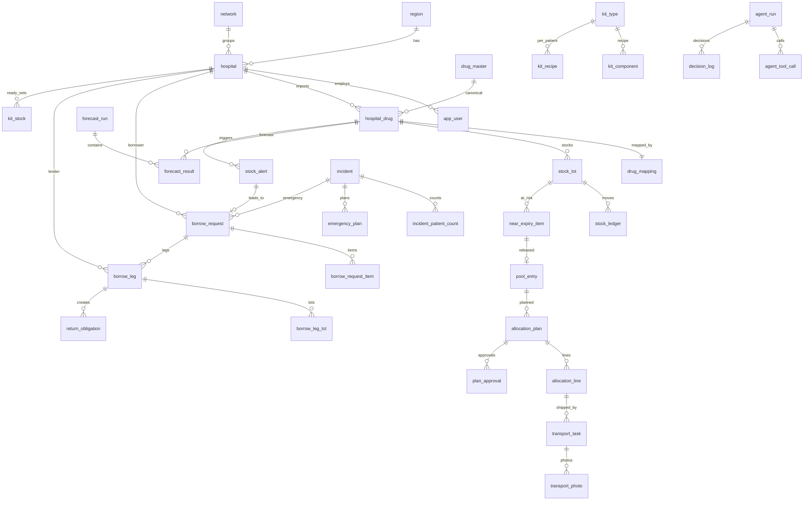

## 12. Data Model

### 12.1 Entity list (62 tables, validated on PostgreSQL)
| Domain | Tables | DB IDs |
|---|---|---|
| Tenancy & identity | region, network, hospital, app_user, app_user_role_history, hospital_distance, config_setting | DB-TEN-001..007 |
| Drug master & mapping | drug_master, hospital_drug, drug_mapping, tmt_reference, mapping_candidate, hospital_import | DB-MAP-001..006 |
| Stock | stock_lot, stock_ledger, stock_snapshot, usage_daily, incoming_order | DB-STK-001..005 |
| Forecasting | forecast_run, forecast_result, forecast_backtest, context_signal | DB-FC-001..004 |
| Alerts | stock_alert | DB-AL-001 |
| Borrowing (F1b) | borrow_request, borrow_request_item, borrow_leg, borrow_leg_lot, return_obligation, reliability_stat, document | DB-BR-001..007 |
| Near-expiry (F2) | near_expiry_item, pool_entry, allocation_plan, allocation_line, plan_approval, transport_task, transport_photo, repeat_expiry_flag | DB-F2-001..008 |
| Emergency (F3) | kit_type, kit_component, kit_recipe, kit_stock, incident, incident_patient_count, emergency_plan, kit_pack_task, incident_usage | DB-F3-001..009 |
| Agents & audit | agent_run, agent_tool_call, decision_log, audit_log, audit_log_context | DB-AG-001..005 |
| Platform | notification, job_run, idempotency_key, value_record, report_definition | DB-PL-001..005 |
| Reference (added) | drug_mapping_history, incident_extra_rule, regional_warehouse_stock, return_receipt, transport_event | DB-REF-001..005 |

### 12.1b Logical-name → physical-table map
Feature sections (§7.16 "Database Entities Used") use logical names; the physical tables in `schema.sql` are authoritative.

| Logical name (§7) | Physical table / column |
|---|---|
| usage_history | usage_daily |
| inventory_lot | stock_lot |
| inventory_transaction | stock_ledger |
| stock_balance | stock_snapshot (+ view over stock_lot) |
| hospital_drug_profile | hospital_drug (ved, abc, expiry_threshold_days) |
| forecast_metric | forecast_backtest |
| open_purchase_order | incoming_order |
| app_config | config_setting |
| ingestion_batch | hospital_import (`errors` jsonb) |
| distance_matrix (`travel_minutes`) | hospital_distance (`travel_minutes`, `travel_minutes_override`) |
| borrow_response | borrow_leg response columns (`qty_accepted`, `responded_at`, `reject_reason`) + borrow_leg_lot |
| expiry_finding | near_expiry_item |
| allocation_plan_approval | plan_approval |
| transport_record / transport_event | transport_task / transport_photo (+ audit_log events) |
| transfer_document(_line) | document (kind TRANSFER_SLIP; lines in payload) |
| drug_local_mapping | drug_mapping |
| drug_mapping_history | drug_mapping_history |
| tmt_concept | tmt_reference |
| preset_kit / incident_kit_rule / kit_component | kit_type / kit_recipe / kit_component |
| incident_extra_rule | incident_extra_rule |
| emergency_incident | incident (+ incident_patient_count) |
| emergency_plan_line | emergency_plan.steps (jsonb) |
| kit_pack_record | kit_pack_task |
| incident_usage_record | incident_usage |
| reconciliation_report | document (INCIDENT_REPORT/UCEP_REPORT) + `GET /incidents/{id}/reconciliation` |
| value_metric_snapshot | value_record |
| report_definition | report_definition |
| regional_warehouse_stock | regional_warehouse_stock |
| `agent_plan.schema` | `output_schema` in `agent-tool-schemas.json` |
| `drug_master.emergency_class` | column `drug_master.emergency_class` (CRITICAL / SUPPORTIVE) |

### 12.2 Key entity specification
| Entity | Purpose | Key fields / constraints | Source rule |
|---|---|---|---|
| hospital | tenant | `lat/lon`, `is_urban` (informational; F3 ETA uses the real-time route, not a speed table), `has_cold_chain`, `has_blood_bank` (rev 1.2), `network_id` (auto-approve) | BR-F3-0xx, BR-F2a-0xx |
| hospital_drug | HIS drug-list row | unique(hospital, local_code); `ved`, `abc`, `expiry_threshold_days` (pharmacist-set, NULL⇒180) | BR-F1a, BR-F2a |
| drug_master (rev 1.2 additions) | canonical drug | `is_blood_product` (excluded from F1/F2; F3 PRC O only); `return_obligation.return_mode` IN_KIND / BLOOD_REPLACEMENT; trigger `borrow_item_blood_guard` allows blood lines only in EMERGENCY context at blood-bank hospitals | ASM-47, BR-F3-031, BR-XC-013 |
| drug_mapping | local→canonical link | `status`, `confidence`, `unit_conversion_factor`, per-hospital pack data (`local_pack_unit`, `base_units_per_pack`, `manufacturer`); CHECK: VERIFIED needs master + verifier + pack data | Q-26, ASM-45, F-32 |
| app_user_role_history | who held which role when | `valid_from/valid_to`, one open row per user; filled by trigger on app_user | SEC-015 |
| audit_log_context | IP / user agent kept apart from the hash-chained row | deletable after 12 months without breaking the chain | ASM-41 |
| return_receipt | partial returns | cumulative base qty must reach borrowed qty (in kind only) | F-30 |
| transport_event | offline-synced driver events | unique(task, client_event_id); `captured_at` vs `received_at` | FR-F2a-016 |
| stock_lot | lot balance | `qty_held ≤ qty_on_hand` (CHECK); held lots excluded from usable stock | ASM-12 |
| stock_ledger | movement truth | append-only trigger; reasons incl. LEND_OUT, BORROW_IN, POOL_TRANSFER_* | ASM-13 |
| forecast_result | per run, per drug | method, p50/p90/p95, total_target, rop, `coverage_ok`, `confidence_flag` | FL-01 |
| stock_alert | alert | partial unique index: 1 open alert per drug/type | FL-02 |
| borrow_request | request | `context` ∈ STOCK_ALERT/MANUAL/EMERGENCY, `ladder` jsonb (frozen), `first_round_qty`, `stop_threshold` | SM-1 |
| borrow_leg | one lender per round | unique(request, lender, round); `score_parts` jsonb; `deadline_at` partial index | F-14..18 |
| near_expiry_item | lot at risk | partial unique: one active item per lot | SM-2 |
| allocation_plan / line | split plan | `cost_ratio`, `economical`, `option_chosen` (4 options) | F-23 |
| plan_approval | per-hospital decision | unique(plan, hospital) | FL-14 |
| transport_task | physical move | cancel requires both `cancel_requested_by` and `cancel_consent_by` | SM-6 |
| kit_recipe | Preset Kit per patient | key (triage, kit_type); `is_critical_min` marks red-only min | BR-F3 |
| emergency_plan | revisioned plan | `estimated_need`, `critical_min`, `buffer`, `steps` jsonb ladder | FL-16 |
| agent_run | LLM audit | `input_hash`, `guardrail_hits`, status OK/INVALID/FALLBACK/ERROR/SKIPPED | §14 |
| audit_log | tamper-evident log | SHA-256 hash chain trigger; update/delete forbidden | SEC-00x |

### 12.3 ER diagram (core relationships)

### 12.4 Why PostgreSQL (DDL rationale)
| Choice | Reason |
|---|---|
| PostgreSQL 16 (RDS) | Relational integrity for stock/ledger; RLS for hospital isolation; jsonb for ladders and agent I/O; partial unique indexes enforce "one open alert / one active expiry item"; mature on AWS. |
| Row-Level Security | Isolation enforced in the DB, not only in app code. Session vars `app.hospital_id/role/region_id` set per request; app role has no BYPASSRLS. Borrowing policies are bilateral (borrower + lender see the request). |
| Ledger + lot balance | `stock_ledger` is append-only (audit); `stock_lot` is the fast balance. Stock moves only at LOADED / receipt / pack-confirm (ASM-13). |
| ENUM types | Illegal states rejected by the DB; transitions enforced by `transition()` service (§11). |
| Hash-chained audit_log | Tamper evidence for regulatory use. Built-in `sha256()`; no extension required. IP / user agent are kept in `audit_log_context` (outside the hash) so PDPA retention can delete them. `app_user_role_history` lets forensics resolve the actor's role at the time of the event. |
| `version` + `updated_at` trigger | Optimistic concurrency (`If-Match`) so two pharmacists cannot approve over each other. |
| No patient PII | ASM-27: incidents hold counts by triage only. |
| Partial indexes | `borrow_leg(deadline_at) WHERE status='SENT'` makes the timeout job cheap. |

Data-retention (ASM-26/ASM-41, confirm with legal): audit_log, ledger and documents 7 years; usage history 10 years; audit context (IP / user agent) 12 months; agent_run inputs 2 years; photos 1 year.

### 12.5 Full DDL
The complete, executable DDL is in `schema.sql` (inlined in Appendix A of the combined file). It was executed against a real PostgreSQL instance: 63 tables, 18 RLS policies, audit chain and append-only triggers verified.
