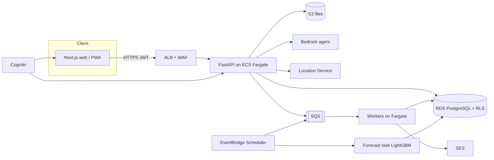
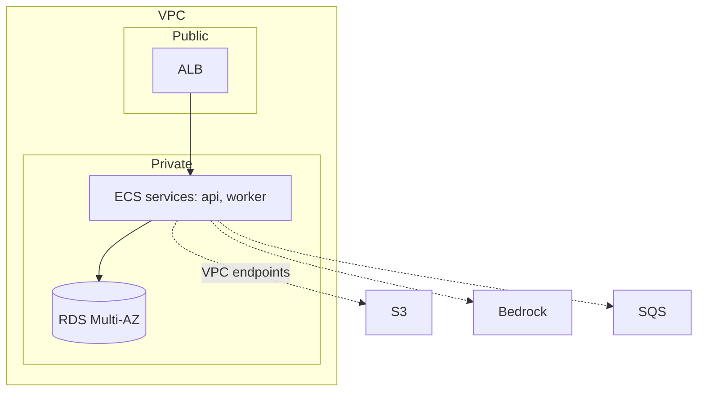

## 18. Security, Privacy and Compliance

| ID | Control | Spec |
|---|---|---|
| SEC-001 | Authentication | Cognito user pool; MFA required for admin/data/audit roles (`security.mfa_required_roles`); idle timeout 30 min |
| SEC-002 | Authorisation | RBAC from §5 matrix enforced in API dependency layer **and** Postgres RLS (defence in depth); deny by default |
| SEC-003 | Tenant isolation | RLS on all hospital-scoped tables; borrowing policies bilateral; app DB role has no BYPASSRLS; integration test per table |
| SEC-004 | Audit | Every write → `audit_log` (actor, role, before/after, request id, ip); hash chain; nightly verify (JOB-15); append-only triggers |
| SEC-015 | Role history | `app_user_role_history` records every role / hospital / region change with validity interval; forensics join audit_log.occurred_at to the interval to see which role the actor really held (even if later revoked). Users are deactivated, never deleted (ASM-41) |
| SEC-005 | Data protection | TLS 1.2+; RDS/S3 encrypted with KMS; presigned URLs ≤15 min; photos private |
| SEC-006 | Patient privacy | No patient identifiers stored (ASM-27); incident = counts only; PDPA data-minimisation |
| SEC-007 | Agent safety | Guardrails G-01..G-12; injection defence; kill switch; no agent writes (§14) |
| SEC-008 | Input validation | Pydantic strict models; file upload type/size limits (10 MB; CSV/XLSX), antivirus scan hook (ASSUMPTION) |
| SEC-009 | Rate limiting | 300 req/min/user; 30 req/min agent endpoints; WAF managed rules |
| SEC-010 | Secrets | AWS Secrets Manager; none in repo; `.env.example` only |
| SEC-011 | Retention | audit/ledger/documents 7 y; usage 10 y; audit context (IP, user agent) 12 months; agent_run 2 y; photos 1 y (`retention.*`, ASM-26/41) |
| SEC-012 | Compliance | PDPA (Thailand); พ.ร.บ./UCEP reporting for incident reconciliation (FL-18). OPEN QUESTION Q-29: formal legal review of inter-hospital drug lending under hospital policy |
| SEC-013 | Human-in-the-loop | Approval gates: borrow ladder, plan, allocation, emergency plan, mapping verification; enforced server-side (state machines) |
| SEC-014 | Pharmacist rule for DATA_ADMIN | A DATA_ADMIN may edit mapping/config only for own scope; drug-affecting rule changes need a pharmacist co-approval (ASSUMPTION) |

## 19. Non-Functional Requirements
All targets are ASSUMPTIONS to be confirmed with the team.

| ID | Category | Requirement |
|---|---|---|
| NFR-001 | Availability | 99.5 % monthly for API; emergency flow (F3) 99.9 % target |
| NFR-002 | Latency | p95 API read < 500 ms; write < 800 ms; plan calculation (F3) < 3 s, shown before any agent output; F3 agent narrative p95 goal ≤ 2 s with the small model (to be measured); borrow proposal without agent < 2 s |
| NFR-003 | Scale | 100 hospitals, 3,000 drugs/hospital, 3 y daily history ≈ 330 M usage rows over life; partition `usage_daily` and `stock_ledger` by year when > 100 M rows |
| NFR-004 | Forecast batch | full nightly run for 100 hospitals × 500 active drugs < 2 h |
| NFR-005 | Recovery | RPO 15 min (RDS PITR), RTO 2 h; multi-AZ |
| NFR-006 | Usability | Thai-first UI; WCAG 2.1 AA; core flows ≤ 3 clicks from alert |
| NFR-007 | Observability | structured JSON logs, request id, CloudWatch metrics (job lag, agent fallback rate, timeout counts), alarms |
| NFR-008 | Correctness | formulas covered by unit + property tests (§25); numeric results reproducible from stored inputs |
| NFR-009 | Cost | agent calls only on propose/response events; est. < 20 calls/hospital/day |
| NFR-011 | Driver offline | Transport screen works with no signal: queue up to 50 photos / 200 MB and 200 status events; sync retries with backoff; zero data loss on app restart; server dedupes by `client_event_id`; sync of 10 queued photos < 60 s on 4G (ASSUMPTION) |
| NFR-010 | Offline resilience | if agent/Location/SES unavailable, workflows continue via fallbacks |

## 20. Technology Stack
STACK_CONSTRAINTS was empty ⇒ proposed modern stack (ASM-30).

| Layer | Choice | Alternatives | Why |
|---|---|---|---|
| Frontend | Next.js 14 (PWA: service worker + IndexedDB queue for drivers) + TypeScript + Tailwind + TanStack Query | Vite+React, SvelteKit | SSR for fast low-end devices, large ecosystem |
| API | FastAPI (Python 3.12) + Pydantic v2 + SQLAlchemy 2 | NestJS, Django | same language as forecasting; auto OpenAPI |
| DB | PostgreSQL 16 (RDS Multi-AZ) | Aurora PG | RLS, jsonb, partial indexes |
| Jobs | EventBridge Scheduler + SQS + ECS Fargate workers | Celery+Redis, Step Functions | managed, scalable, cheap |
| Forecasting | statsmodels/numpy + LightGBM quantile (Fargate scheduled task) | Prophet, SageMaker | small data, deterministic, no endpoints to run |
| Agent | Amazon Bedrock (Claude, tool use) | direct Anthropic API | stays inside AWS account |
| Auth | Cognito | Auth0 | native MFA + JWT |
| Files | S3 + presigned URLs | EFS | photos, PDFs, imports |
| Routing | Amazon Location Service | Google Maps | AWS-native |
| Email | SES | SNS | simple |
| IaC | AWS CDK (TypeScript) | Terraform | typed |
| CI/CD | GitHub Actions → ECR → ECS | CodePipeline | familiar |
| PDF | WeasyPrint (Thai fonts: Sarabun) | ReportLab | HTML templates |

## 21. Architecture Diagrams


Deployment: environments `dev`, `staging`, `prod`; blue/green via ECS; DB migrations by Alembic run as a one-off task using the migrator role.

## 22. Repository Structure
```
doorare/
├─ apps/
│  ├─ web/                 # Next.js (UI-01..UI-19)
│  ├─ api/                 # FastAPI modular monolith
│  │  └─ doorare/
│  │     ├─ modules/{forecast,alerts,borrow,expiry,emergency,mapping,docs,value,admin}/
│  │     ├─ domain/formulas/   # F-01..F-32 pure functions (no I/O)
│  │     ├─ domain/state/      # transition() + SM tables
│  │     ├─ agents/{tools,prompts,guardrails,runner}.py
│  │     ├─ core/{auth,rls,audit,idempotency,config}.py
│  │     └─ worker.py
│  └─ forecast/            # LightGBM / MA-ES batch image
├─ db/{schema.sql,migrations/,seed/}
├─ contracts/{openapi.yaml,agent-tool-schemas.json,config-defaults.yaml}
├─ infra/cdk/
├─ tests/{unit,property,integration,agent_eval,e2e}/
├─ docs/{spec,adr}/
├─ docker-compose.yml
└─ .env.example
```
Module rule: modules talk through service interfaces and domain events, not each other's tables. `domain/formulas` has no database or network imports (enforced by import-linter).

## 23. Configuration
Source of truth: `config-defaults.yaml` (loaded into `config_setting` at first deploy). Lookup order: HOSPITAL → REGION → GLOBAL → file default. Every change is audited with a reason; changes to `borrow.score.*`, `ved.z.*`, `agent.*` require REGION_ADMIN or above.

| Group | Keys | Default | Rule IDs |
|---|---|---|---|
| forecast | min_history_days_cold_start / cv_threshold / active_day_ratio_threshold / price_high_thb / price_low_thb / stale_days / coverage_tolerance / overstock_multiple | 90 / 0.5 / 0.30 / 1000 / 50 / 7 / 0.05 / 2 | BR-F1a |
| ved, abc | z V 1.65, E 1.28; quantile 0.95/0.90; cutoffs 0.70/0.90 | as listed | BR-F1a |
| borrow | stop_ratio V 0.90 / E 1.00; max_parallel 3; timeouts 120/360/2880 min; reminder 0.5; weights 0.45/0.28/0.17/0.10; lot_min_remaining_days 180 | as listed | BR-F1b |
| agent | enabled, model_id, f3_model_id, max_steps 12, timeout 60 s (F3 8 s), urgency_raise_max 1 | as listed | §14 |
| expiry | threshold 180 d; cost ratio 0.20; cost model 300+8/km+500 cold; approval timeout 48 h; repeat 2/3/10,000 THB | as listed | BR-F2a |
| return | 30 d, reminders 7,1 (in kind only, blood by replacement; no payment option) | as listed | BR-XC |
| emergency | timeouts 3/5 min; speeds 20/35/60 km/h; duplicate 10 min/500 m | as listed | BR-F3 |
| mapping | thresholds 0.85/0.60; weights 0.40/0.30/0.20/0.10; SLA 3 d; bulk verify off | as listed | BR-F2b |
| network, transport, coldchain | auto_approve true; photos ≤10; box 6 h | as listed | BR-F2a |

`.env.example` holds only infrastructure settings; business thresholds live in config.
