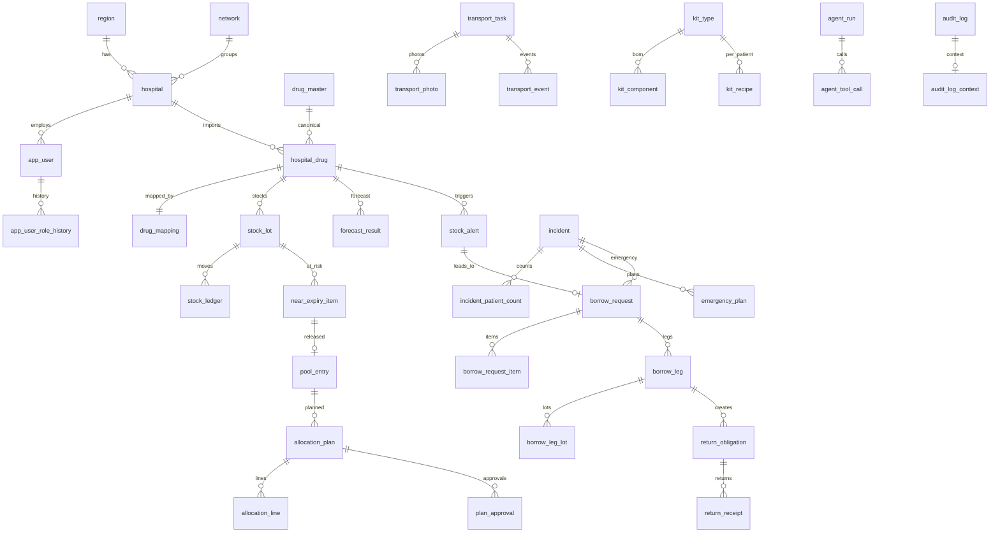

# DooRare — Database Schema (PostgreSQL 16)

เอกสารอธิบายฐานข้อมูลของ DooRare ทุกตาราง สร้างจาก `schema.sql` ฉบับล่าสุด (เวอร์ชันสเปค 1.3) ที่รันบน PostgreSQL จริงผ่านแล้ว  
ตัวเลขรวม: **62 ตาราง**, **23 enum**, **18 RLS policy**, **2 view**, trigger สำคัญ 6 ชุด

> ไฟล์ `schema.sql` คือตัวจริงที่รันได้ เอกสารนี้ช่วยอ่านเข้าใจ ถ้าไม่ตรงกัน ให้ยึด `schema.sql`

## ภาพรวม: เรื่องสำคัญที่ใช้ทั้ง schema

| หลักการ | ทำอย่างไรใน schema |
|---|---|
| แยกข้อมูลรายโรงพยาบาล | Row-Level Security (RLS) ตาม `app.hospital_id` / `app.role` / `app.region_id` ที่แอปตั้งทุกคำขอ; role ของแอป `doorare_app` ไม่ใช่ superuser |
| ไม่ใช้ AI คำนวณตัวเลข | schema เก็บผลที่โค้ดคำนวณ (เช่น `score_si`, `r_value`, `total_target`) ตารางของ Agent เก็บแค่ข้อเสนอและ log |
| สต็อกตรวจสอบย้อนหลังได้ | ยอดล็อตอยู่ใน `stock_lot` ส่วนการเคลื่อนไหวทุกครั้งอยู่ใน `stock_ledger` ซึ่งห้ามแก้/ลบ |
| ล็อกพร้อมกัน | ตารางที่แก้ได้มี `version` และ `updated_at` (trigger เพิ่ม version เอง) ใช้ `If-Match` ในระดับ API |
| audit ปลอมแปลงไม่ได้ | `audit_log` เชื่อม hash แบบลูกโซ่ และห้าม UPDATE/DELETE |
| ไม่เก็บข้อมูลผู้ป่วย | เหตุฉุกเฉินเก็บเพียงจำนวนตาม triage |
| คืนยาแบบเดียวกันเท่านั้น | `return_obligation` ไม่มีช่องวิธีจ่ายเงิน; ปิดเมื่อคืนยาชนิดเดียวกันครบจำนวน |
| หน่วยและขนาดแพ็ค | จำนวนทั้งหมดเทียบเป็นหน่วยฐาน (base unit) ผ่าน `unit_conversion_factor` และขนาดแพ็คของ `drug_mapping` / `stock_lot` (สูตร F-32) |

## แผนภาพความสัมพันธ์หลัก (ER)

## 1. องค์กรและผู้ใช้ (Tenancy & Identity)

แยกข้อมูลตามเขตสุขภาพ เครือข่าย และโรงพยาบาล พร้อมผู้ใช้และสิทธิ์

| ตาราง | ใช้ทำอะไร |
|---|---|
| `region` | เขตสุขภาพ (Health region) ระดับบนสุดของการแบ่งข้อมูล |
| `network` | เครือข่ายโรงพยาบาลในเขต ใช้ตัดสินว่า "เครือข่ายเดียวกัน" เพื่ออนุมัติอัตโนมัติ |
| `hospital` | โรงพยาบาลแต่ละแห่ง (หน่วยแยกข้อมูลหลัก / tenant) |
| `app_user` | ผู้ใช้ระบบ เชื่อมกับ Cognito |
| `app_user_role_history` | ประวัติ role ของผู้ใช้ ว่า ณ เวลาใดถือ role/โรงพยาบาลอะไร |
| `hospital_distance` | ระยะทางและเวลาเดินทางระหว่างโรงพยาบาลคู่หนึ่ง (distance matrix) สำหรับ F1 |
| `config_setting` | ค่าตั้งต้นที่ปรับได้ (threshold, น้ำหนักคะแนน ฯลฯ) |

### `region`

เขตสุขภาพ (Health region) ระดับบนสุดของการแบ่งข้อมูล

**จุดสำคัญ:** รหัสเขตไม่ซ้ำ (`code`)

| คอลัมน์ | ชนิด | Null | ค่าเริ่มต้น | ข้อกำหนด |
|---|---|---|---|---|
| `id` | uuid |  |  | PK |
| `code` | text |  |  | UNIQUE |
| `name_th` | text |  |  |  |
| `name_en` | text | ว่างได้ |  |  |
| `created_at` | timestamptz |  | now |  |

### `network`

เครือข่ายโรงพยาบาลในเขต ใช้ตัดสินว่า "เครือข่ายเดียวกัน" เพื่ออนุมัติอัตโนมัติ

**จุดสำคัญ:** `auto_approve` เปิด/ปิดอนุมัติอัตโนมัติของ F2

| คอลัมน์ | ชนิด | Null | ค่าเริ่มต้น | ข้อกำหนด |
|---|---|---|---|---|
| `id` | uuid |  |  | PK |
| `region_id` | uuid |  |  | → `→ region` |
| `name` | text |  |  |  |
| `auto_approve` | boolean |  | true |  |

### `hospital`

โรงพยาบาลแต่ละแห่ง (หน่วยแยกข้อมูลหลัก / tenant)

**จุดสำคัญ:** `lat/lon` ใช้คำนวณเส้นทาง, `has_cold_chain` มีห้องเย็นหรือไม่, `has_blood_bank` มีธนาคารเลือดหรือไม่ (ยืม PRC กลุ่ม O ได้เฉพาะ F3), `network_id` เครือข่ายที่สังกัด

| คอลัมน์ | ชนิด | Null | ค่าเริ่มต้น | ข้อกำหนด |
|---|---|---|---|---|
| `id` | uuid |  |  | PK |
| `region_id` | uuid |  |  | → `→ region` |
| `network_id` | uuid | ว่างได้ |  | → `→ network` |
| `code` | text |  |  | UNIQUE |
| `name_th` | text |  |  |  |
| `name_en` | text | ว่างได้ |  |  |
| `lat` | numeric(9,6) | ว่างได้ |  |  |
| `lon` | numeric(9,6) | ว่างได้ |  |  |
| `is_urban` | boolean |  | true |  |
| `has_cold_chain` | boolean |  | false |  |
| `has_blood_bank` | boolean |  | false |  |
| `active` | boolean |  | true |  |
| `created_at` | timestamptz |  | now |  |
| `updated_at` | timestamptz |  | now |  |
| `version` | integer |  | 1 |  |

### `app_user`

ผู้ใช้ระบบ เชื่อมกับ Cognito

**จุดสำคัญ:** ไม่ลบแถว (trigger ห้าม DELETE) ใช้ปิดบัญชี `active=false` แทน เพื่อให้ audit ย้อนดูได้

| คอลัมน์ | ชนิด | Null | ค่าเริ่มต้น | ข้อกำหนด |
|---|---|---|---|---|
| `id` | uuid |  |  | PK |
| `cognito_sub` | text |  |  | UNIQUE |
| `email` | text |  |  | UNIQUE |
| `display_name` | text |  |  |  |
| `role` | role_code |  |  |  |
| `hospital_id` | uuid | ว่างได้ |  | → `→ hospital` |
| `region_id` | uuid | ว่างได้ |  | → `→ region` |
| `phone` | text | ว่างได้ |  |  |
| `active` | boolean |  | true |  |
| `created_at` | timestamptz |  | now |  |

### `app_user_role_history`

ประวัติ role ของผู้ใช้ ว่า ณ เวลาใดถือ role/โรงพยาบาลอะไร

**จุดสำคัญ:** trigger เติมให้อัตโนมัติเมื่อ role/โรงพยาบาล/สถานะเปลี่ยน มีแถวเปิด (valid_to ว่าง) ได้ 1 แถวต่อผู้ใช้

| คอลัมน์ | ชนิด | Null | ค่าเริ่มต้น | ข้อกำหนด |
|---|---|---|---|---|
| `id` | bigint |  |  | PK |
| `user_id` | uuid |  |  | → `→ app_user` |
| `role` | role_code |  |  |  |
| `hospital_id` | uuid | ว่างได้ |  | → `→ hospital` |
| `region_id` | uuid | ว่างได้ |  | → `→ region` |
| `valid_from` | timestamptz |  | now |  |
| `valid_to` | timestamptz | ว่างได้ |  |  |
| `changed_by` | uuid | ว่างได้ |  | → `→ app_user` |
| `reason` | text | ว่างได้ |  |  |

### `hospital_distance`

ระยะทางและเวลาเดินทางระหว่างโรงพยาบาลคู่หนึ่ง (distance matrix) สำหรับ F1

**จุดสำคัญ:** `travel_minutes` ค่าที่เก็บไว้, `travel_minutes_override` แอดมินแก้ได้ — F3 ไม่ใช้ตารางนี้ ใช้เรียกเส้นทางเรียลไทม์

| คอลัมน์ | ชนิด | Null | ค่าเริ่มต้น | ข้อกำหนด |
|---|---|---|---|---|
| `from_hospital_id` | uuid |  |  | PK → `→ hospital` |
| `to_hospital_id` | uuid |  |  | PK → `→ hospital` |
| `distance_km` | numeric(8,2) |  |  |  |
| `duration_min_normal` | numeric(8,1) | ว่างได้ |  |  |
| `duration_min_peak` | numeric(8,1) | ว่างได้ |  |  |
| `travel_minutes` | numeric(8,1) | ว่างได้ |  |  |
| `travel_minutes_override` | numeric(8,1) | ว่างได้ |  |  |
| `source` | text |  | 'LOCATION_SERVICE'::text |  |
| `refreshed_at` | timestamptz |  | now |  |

### `config_setting`

ค่าตั้งต้นที่ปรับได้ (threshold, น้ำหนักคะแนน ฯลฯ)

**จุดสำคัญ:** คีย์ + ขอบเขต `GLOBAL | REGION:<id> | HOSPITAL:<id>` ค่าเป็น jsonb

| คอลัมน์ | ชนิด | Null | ค่าเริ่มต้น | ข้อกำหนด |
|---|---|---|---|---|
| `key` | text |  |  | PK |
| `scope` | text |  | 'GLOBAL'::text | PK |
| `value` | jsonb |  |  |  |
| `description` | text | ว่างได้ |  |  |
| `updated_by` | uuid | ว่างได้ |  | → `→ app_user` |
| `updated_at` | timestamptz |  | now |  |

## 2. ทะเบียนยา/เวชภัณฑ์และการจับคู่รหัส (Drug Master & Mapping, F4 ส่วนย่อยของ F2 §6)

แปลงรหัสของแต่ละโรงพยาบาลให้เป็นรายการกลาง: ยา → TMT, เวชภัณฑ์/เลือด → รายการกลางที่แอดมินกำหนด (ไม่ใช้รหัส 24 หลักแล้ว)

| ตาราง | ใช้ทำอะไร |
|---|---|
| `drug_master` | ยากลางของทั้งเขต (สร้างจากการจับคู่ที่ Verified แล้ว) |
| `hospital_drug` | รายการยาจาก HIS ของแต่ละโรงพยาบาล (นำเข้า) |
| `drug_mapping` | การจับคู่ยาท้องถิ่น → ยากลาง พร้อมสถานะและความมั่นใจ |
| `tmt_reference` | อ้างอิง TMT (ระดับ GPU/TPU/GPP/TPP) |
| `mapping_candidate` | ตัวเลือกที่ระบบแนะนำสำหรับแต่ละการจับคู่ พร้อมคะแนนแยกส่วน |
| `drug_mapping_history` | ประวัติการเปลี่ยนสถานะของการจับคู่ |
| `hospital_import` | บันทึกการนำเข้าไฟล์จาก HIS (รายการยา, สต็อก, การใช้, ล็อต) |

### `drug_master`

ยากลางของทั้งเขต (สร้างจากการจับคู่ที่ Verified แล้ว)

**จุดสำคัญ:** `item_type` DRUG/SUPPLY/BLOOD, `gp_id` รหัส TMT GP (ยาต้องมี เวชภัณฑ์/เลือดว่าง), `internal_code` รหัสภายในของรายการกลาง (เวชภัณฑ์/เลือด), `emergency_class` CRITICAL/SUPPORTIVE สำหรับ timeout 3/5 นาทีของ F3, `is_cold_chain`, `is_blood_product` เลือด (ข้ามใน F1/F2 ยืมได้เฉพาะ PRC O ใน F3)

| คอลัมน์ | ชนิด | Null | ค่าเริ่มต้น | ข้อกำหนด |
|---|---|---|---|---|
| `id` | uuid |  |  | PK |
| `item_type` | catalog_item_type |  | 'DRUG'::catalog_item_type |  |
| `gp_id` | text | ว่างได้ |  | UNIQUE |
| `internal_code` | text | ว่างได้ |  | UNIQUE |
| `generic_name` | text |  |  |  |
| `strength` | text | ว่างได้ |  |  |
| `dosage_form` | text | ว่างได้ |  |  |
| `base_unit` | text |  |  |  |
| `is_cold_chain` | boolean |  | false |  |
| `is_blood_product` | boolean |  | false |  |
| `is_high_alert` | boolean |  | false |  |
| `emergency_class` | text |  | 'SUPPORTIVE'::text |  |
| `created_at` | timestamptz |  | now |  |

### `hospital_drug`

รายการยาจาก HIS ของแต่ละโรงพยาบาล (นำเข้า)

**จุดสำคัญ:** `ved`, `abc`, `expiry_threshold_days` (เภสัชกรกำหนด ว่าง = ใช้ค่า default 180 วัน), `drug_master_id` ลิงก์ไปยากลาง

| คอลัมน์ | ชนิด | Null | ค่าเริ่มต้น | ข้อกำหนด |
|---|---|---|---|---|
| `id` | uuid |  |  | PK |
| `hospital_id` | uuid |  |  | → `→ hospital` |
| `local_code` | text |  |  |  |
| `local_name` | text |  |  |  |
| `unit_price_thb` | numeric(12,2) | ว่างได้ |  |  |
| `local_unit` | text |  |  |  |
| `tmt_id` | text | ว่างได้ |  |  |
| `gp_id` | text | ว่างได้ |  |  |
| `active` | boolean |  | true |  |
| `ved` | ved_class |  | 'E'::ved_class |  |
| `abc` | abc_class | ว่างได้ |  |  |
| `expiry_threshold_days` | integer | ว่างได้ |  |  |
| `drug_master_id` | uuid | ว่างได้ |  | → `→ drug_master` |

### `drug_mapping`

การจับคู่ยาท้องถิ่น → ยากลาง พร้อมสถานะและความมั่นใจ

**จุดสำคัญ:** `method` TMT (ระบบแนะนำ, ยา) หรือ CENTRAL_LIST (เลือกจากรายการกลาง, เวชภัณฑ์/เลือด ไม่มีคะแนน); `status` UNMATCHED/SUGGESTED/VERIFIED/REJECTED; `unit_conversion_factor` + ข้อมูลแพ็ค (`local_pack_unit`, `base_units_per_pack`, `manufacturer`); จะ VERIFIED ได้ต้องมียากลาง ผู้ยืนยัน และขนาดแพ็ค

| คอลัมน์ | ชนิด | Null | ค่าเริ่มต้น | ข้อกำหนด |
|---|---|---|---|---|
| `id` | uuid |  |  | PK |
| `hospital_drug_id` | uuid |  |  | UNIQUE → `→ hospital_drug` |
| `drug_master_id` | uuid | ว่างได้ |  | → `→ drug_master` |
| `status` | mapping_status |  | 'UNMATCHED'::mapping_status |  |
| `method` | text |  | 'TMT'::text |  |
| `confidence` | numeric(4,3) | ว่างได้ |  |  |
| `unit_conversion_factor` | numeric(14,6) |  | 1 |  |
| `local_pack_unit` | text | ว่างได้ |  |  |
| `base_units_per_pack` | numeric(14,3) | ว่างได้ |  |  |
| `manufacturer` | text | ว่างได้ |  |  |
| `suggested_by` | text |  | 'RULES'::text |  |
| `verified_by` | uuid | ว่างได้ |  | → `→ app_user` |
| `verified_at` | timestamptz | ว่างได้ |  |  |
| `reject_reason` | text | ว่างได้ |  |  |
| `created_at` | timestamptz |  | now |  |
| `updated_at` | timestamptz |  | now |  |
| `version` | integer |  | 1 |  |

### `tmt_reference`

อ้างอิง TMT (ระดับ GPU/TPU/GPP/TPP)

**จุดสำคัญ:** โครงสร้างแบบต้นไม้ผ่าน `parent_tmt_id`

| คอลัมน์ | ชนิด | Null | ค่าเริ่มต้น | ข้อกำหนด |
|---|---|---|---|---|
| `tmt_id` | text |  |  | PK |
| `level` | text |  |  |  |
| `name` | text |  |  |  |
| `parent_tmt_id` | text | ว่างได้ |  |  |
| `gp_id` | text | ว่างได้ |  |  |

### `mapping_candidate`

ตัวเลือกที่ระบบแนะนำสำหรับแต่ละการจับคู่ พร้อมคะแนนแยกส่วน

**จุดสำคัญ:** `score_parts` jsonb แจกแจงที่มาของคะแนน, `rank` ลำดับ

| คอลัมน์ | ชนิด | Null | ค่าเริ่มต้น | ข้อกำหนด |
|---|---|---|---|---|
| `id` | uuid |  |  | PK |
| `drug_mapping_id` | uuid |  |  | → `→ drug_mapping` |
| `tmt_id` | text | ว่างได้ |  | → `→ tmt_reference` |
| `score` | numeric(4,3) |  |  |  |
| `score_parts` | jsonb |  |  |  |
| `rank` | integer |  |  |  |

### `drug_mapping_history`

ประวัติการเปลี่ยนสถานะของการจับคู่

**จุดสำคัญ:** ใครเปลี่ยนจากสถานะไหนเป็นสถานะไหน เมื่อไร

| คอลัมน์ | ชนิด | Null | ค่าเริ่มต้น | ข้อกำหนด |
|---|---|---|---|---|
| `id` | bigint |  |  | PK |
| `drug_mapping_id` | uuid |  |  | → `→ drug_mapping` |
| `from_status` | mapping_status | ว่างได้ |  |  |
| `to_status` | mapping_status |  |  |  |
| `actor_id` | uuid | ว่างได้ |  | → `→ app_user` |
| `note` | text | ว่างได้ |  |  |
| `occurred_at` | timestamptz |  | now |  |

### `hospital_import`

บันทึกการนำเข้าไฟล์จาก HIS (รายการยา, สต็อก, การใช้, ล็อต)

**จุดสำคัญ:** `rows_ok/rows_error`, `errors` jsonb เก็บแถวที่ผิด

| คอลัมน์ | ชนิด | Null | ค่าเริ่มต้น | ข้อกำหนด |
|---|---|---|---|---|
| `id` | uuid |  |  | PK |
| `hospital_id` | uuid |  |  | → `→ hospital` |
| `kind` | text |  |  |  |
| `file_key` | text |  |  |  |
| `rows_total` | integer | ว่างได้ |  |  |
| `rows_ok` | integer | ว่างได้ |  |  |
| `rows_error` | integer | ว่างได้ |  |  |
| `errors` | jsonb | ว่างได้ |  |  |
| `created_by` | uuid | ว่างได้ |  | → `→ app_user` |
| `created_at` | timestamptz |  | now |  |

## 3. สต็อก (Stock)

ยอดคงเหลือรายล็อต สมุดบัญชีการเคลื่อนไหว และประวัติการใช้

| ตาราง | ใช้ทำอะไร |
|---|---|
| `stock_lot` | ยอดคงเหลือรายล็อต (lot) ของแต่ละยาในแต่ละโรงพยาบาล |
| `stock_ledger` | สมุดบัญชีการเคลื่อนไหวสต็อก (เพิ่มได้อย่างเดียว ห้ามแก้/ลบ) |
| `stock_snapshot` | ภาพรวมสต็อกรายวันต่อโรงพยาบาลต่อยา |
| `usage_daily` | ปริมาณการใช้ยารายวัน |
| `incoming_order` | ใบสั่งซื้อที่กำลังจะมาถึง |

### `stock_lot`

ยอดคงเหลือรายล็อต (lot) ของแต่ละยาในแต่ละโรงพยาบาล

**จุดสำคัญ:** `qty_on_hand` คงเหลือ, `qty_held` ถูกกันไว้ (ห้ามเกินคงเหลือ), `expiry_date`, `pack_size_base_units`/`manufacturer` ทับค่าแพ็คของ mapping ได้

| คอลัมน์ | ชนิด | Null | ค่าเริ่มต้น | ข้อกำหนด |
|---|---|---|---|---|
| `id` | uuid |  |  | PK |
| `hospital_id` | uuid |  |  | → `→ hospital` |
| `hospital_drug_id` | uuid |  |  | → `→ hospital_drug` |
| `lot_no` | text |  |  |  |
| `expiry_date` | date |  |  |  |
| `manufacturer` | text | ว่างได้ |  |  |
| `pack_size_base_units` | numeric(14,3) | ว่างได้ |  |  |
| `qty_on_hand` | numeric(14,3) |  | 0 |  |
| `qty_held` | numeric(14,3) |  | 0 |  |
| `updated_at` | timestamptz |  | now |  |
| `version` | integer |  | 1 |  |

### `stock_ledger`

สมุดบัญชีการเคลื่อนไหวสต็อก (เพิ่มได้อย่างเดียว ห้ามแก้/ลบ)

**จุดสำคัญ:** `delta` บวก/ลบ, `reason` (LEND_OUT, BORROW_IN, RETURN_IN ฯลฯ), `ref_type/ref_id` ชี้ไปต้นเหตุ

| คอลัมน์ | ชนิด | Null | ค่าเริ่มต้น | ข้อกำหนด |
|---|---|---|---|---|
| `id` | bigint |  |  | PK |
| `hospital_id` | uuid |  |  | → `→ hospital` |
| `lot_id` | uuid |  |  | → `→ stock_lot` |
| `delta` | numeric(14,3) |  |  |  |
| `reason` | ledger_reason |  |  |  |
| `ref_type` | text | ว่างได้ |  |  |
| `ref_id` | uuid | ว่างได้ |  |  |
| `occurred_at` | timestamptz |  | now |  |
| `actor_id` | uuid | ว่างได้ |  | → `→ app_user` |

### `stock_snapshot`

ภาพรวมสต็อกรายวันต่อโรงพยาบาลต่อยา

**จุดสำคัญ:** ใช้เป็นข้อมูลให้ forecast/alert; รวม `qty_incoming`, `qty_held`

| คอลัมน์ | ชนิด | Null | ค่าเริ่มต้น | ข้อกำหนด |
|---|---|---|---|---|
| `hospital_id` | uuid |  |  | PK → `→ hospital` |
| `hospital_drug_id` | uuid |  |  | PK → `→ hospital_drug` |
| `snap_date` | date |  |  | PK |
| `qty_on_hand` | numeric(14,3) |  |  |  |
| `qty_incoming` | numeric(14,3) |  | 0 |  |
| `qty_held` | numeric(14,3) |  | 0 |  |

### `usage_daily`

ปริมาณการใช้ยารายวัน

**จุดสำคัญ:** ข้อมูลหลักของการพยากรณ์ (10 ปีย้อนหลังสำหรับ mock data)

| คอลัมน์ | ชนิด | Null | ค่าเริ่มต้น | ข้อกำหนด |
|---|---|---|---|---|
| `hospital_id` | uuid |  |  | PK → `→ hospital` |
| `hospital_drug_id` | uuid |  |  | PK → `→ hospital_drug` |
| `usage_date` | date |  |  | PK |
| `qty_used` | numeric(14,3) |  |  |  |

### `incoming_order`

ใบสั่งซื้อที่กำลังจะมาถึง

**จุดสำคัญ:** `expected_date`, `lead_time_days` ใช้หา L ในสูตร F-09

| คอลัมน์ | ชนิด | Null | ค่าเริ่มต้น | ข้อกำหนด |
|---|---|---|---|---|
| `id` | uuid |  |  | PK |
| `hospital_id` | uuid |  |  | → `→ hospital` |
| `hospital_drug_id` | uuid |  |  | → `→ hospital_drug` |
| `qty` | numeric(14,3) |  |  |  |
| `expected_date` | date |  |  |  |
| `status` | text |  | 'OPEN'::text |  |
| `lead_time_days` | integer | ว่างได้ |  |  |

## 4. การพยากรณ์และสัญญาณบริบท (Forecasting, F1a)

ผลพยากรณ์ ค่าเป้าหมาย และการทดสอบย้อนหลัง

| ตาราง | ใช้ทำอะไร |
|---|---|
| `forecast_run` | การรันพยากรณ์แต่ละรอบ |
| `forecast_result` | ผลพยากรณ์รายยา/รายโรงพยาบาลต่อรอบ |
| `forecast_backtest` | ผลทดสอบย้อนหลังรายสัปดาห์ (ทำนาย vs จริง vs residual) |
| `context_signal` | สัญญาณบริบท เช่น ฤดูกาล การระบาด (XC-3) |

### `forecast_run`

การรันพยากรณ์แต่ละรอบ

**จุดสำคัญ:** `status`, `model_version`, `n_fallback` จำนวนที่ตกไปใช้วิธีสำรอง

| คอลัมน์ | ชนิด | Null | ค่าเริ่มต้น | ข้อกำหนด |
|---|---|---|---|---|
| `id` | uuid |  |  | PK |
| `started_at` | timestamptz |  | now |  |
| `finished_at` | timestamptz | ว่างได้ |  |  |
| `status` | job_status |  | 'RUNNING'::job_status |  |
| `model_version` | text | ว่างได้ |  |  |
| `n_items` | integer | ว่างได้ |  |  |
| `n_fallback` | integer | ว่างได้ |  |  |
| `notes` | text | ว่างได้ |  |  |

### `forecast_result`

ผลพยากรณ์รายยา/รายโรงพยาบาลต่อรอบ

**จุดสำคัญ:** `method` (MA_ES/QUANTILE_LGBM/MIN_MAX/COLD_START), `demand_pattern` (REGULAR/INTERMITTENT/NO_USAGE), `lead_time_quantile` ใช้กับ F-09 สูตร B, `p50/p90/p95`, `total_target`, `rop`, `coverage_ok`

| คอลัมน์ | ชนิด | Null | ค่าเริ่มต้น | ข้อกำหนด |
|---|---|---|---|---|
| `id` | uuid |  |  | PK |
| `run_id` | uuid |  |  | → `→ forecast_run` |
| `hospital_id` | uuid |  |  | → `→ hospital` |
| `hospital_drug_id` | uuid |  |  | → `→ hospital_drug` |
| `method` | forecast_method |  |  |  |
| `ved` | ved_class |  |  |  |
| `abc` | abc_class | ว่างได้ |  |  |
| `u_per_day` | numeric(14,4) |  |  |  |
| `sigma_per_day` | numeric(14,4) | ว่างได้ |  |  |
| `lead_time_days` | numeric(6,2) |  |  |  |
| `demand_pattern` | text |  | 'REGULAR'::text |  |
| `lead_time_quantile` | numeric(14,3) | ว่างได้ |  |  |
| `p50` | numeric(14,3) | ว่างได้ |  |  |
| `p90` | numeric(14,3) | ว่างได้ |  |  |
| `p95` | numeric(14,3) | ว่างได้ |  |  |
| `total_target` | numeric(14,3) | ว่างได้ |  |  |
| `rop` | numeric(14,3) | ว่างได้ |  |  |
| `min_level` | numeric(14,3) | ว่างได้ |  |  |
| `max_level` | numeric(14,3) | ว่างได้ |  |  |
| `confidence_flag` | text | ว่างได้ |  |  |
| `coverage_ok` | boolean | ว่างได้ |  |  |
| `computed_at` | timestamptz |  | now |  |

### `forecast_backtest`

ผลทดสอบย้อนหลังรายสัปดาห์ (ทำนาย vs จริง vs residual)

**จุดสำคัญ:** ใช้หาควอนไทล์ของ MA/ES และวัด coverage

| คอลัมน์ | ชนิด | Null | ค่าเริ่มต้น | ข้อกำหนด |
|---|---|---|---|---|
| `id` | uuid |  |  | PK |
| `run_id` | uuid |  |  | → `→ forecast_run` |
| `hospital_id` | uuid |  |  |  |
| `hospital_drug_id` | uuid |  |  |  |
| `week_start` | date |  |  |  |
| `predicted` | numeric(14,3) | ว่างได้ |  |  |
| `actual` | numeric(14,3) | ว่างได้ |  |  |
| `residual` | numeric(14,3) | ว่างได้ |  |  |

### `context_signal`

สัญญาณบริบท เช่น ฤดูกาล การระบาด (XC-3)

**จุดสำคัญ:** Agent ใช้ประกอบคำแนะนำเท่านั้น ต้องมีผู้อนุมัติ

| คอลัมน์ | ชนิด | Null | ค่าเริ่มต้น | ข้อกำหนด |
|---|---|---|---|---|
| `id` | uuid |  |  | PK |
| `region_id` | uuid | ว่างได้ |  | → `→ region` |
| `signal_type` | text |  |  |  |
| `payload` | jsonb |  |  |  |
| `valid_from` | date |  |  |  |
| `valid_to` | date | ว่างได้ |  |  |
| `source` | text |  |  |  |
| `approved_by` | uuid | ว่างได้ |  | → `→ app_user` |
| `created_at` | timestamptz |  | now |  |

## 5. การแจ้งเตือนสต็อก (Alerts)

เตือนเมื่อสต็อกต่ำหรือเกิน

| ตาราง | ใช้ทำอะไร |
|---|---|
| `stock_alert` | การแจ้งเตือนสต็อก |

### `stock_alert`

การแจ้งเตือนสต็อก

**จุดสำคัญ:** ระดับ NORMAL/URGENT/VERY_URGENT; unique index: เปิดได้ 1 รายการต่อยา/ประเภท; `days_cover` วันที่ยังใช้ได้, `suggested_borrow_qty`

| คอลัมน์ | ชนิด | Null | ค่าเริ่มต้น | ข้อกำหนด |
|---|---|---|---|---|
| `id` | uuid |  |  | PK |
| `hospital_id` | uuid |  |  | → `→ hospital` |
| `hospital_drug_id` | uuid |  |  | → `→ hospital_drug` |
| `type` | alert_type |  |  |  |
| `severity` | alert_severity |  | 'NORMAL'::alert_severity |  |
| `status` | alert_status |  | 'OPEN'::alert_status |  |
| `stock_qty` | numeric(14,3) | ว่างได้ |  |  |
| `incoming_qty` | numeric(14,3) | ว่างได้ |  |  |
| `days_cover` | numeric(8,2) | ว่างได้ |  |  |
| `suggested_borrow_qty` | numeric(14,3) | ว่างได้ |  |  |
| `forecast_result_id` | uuid | ว่างได้ |  | → `→ forecast_result` |
| `snoozed_until` | timestamptz | ว่างได้ |  |  |
| `created_at` | timestamptz |  | now |  |
| `updated_at` | timestamptz |  | now |  |
| `version` | integer |  | 1 |  |

## 6. การยืมระหว่างโรงพยาบาล (Borrowing, F1b + เอกสาร/การคืน)

คำขอยืม ลำดับผู้ให้ยืม การตอบรับ การคืนยา

| ตาราง | ใช้ทำอะไร |
|---|---|
| `borrow_request` | คำขอยืมหนึ่งรายการ |
| `borrow_request_item` | รายการที่ขอ (ยา หรือชุดเซ็ต KIT) |
| `borrow_leg` | การส่งคำขอไปยังผู้ให้ยืมหนึ่งแห่งในหนึ่งรอบ |
| `borrow_leg_lot` | ล็อตที่ผู้ให้ยืมเสนอให้ในแต่ละ leg |
| `return_obligation` | ภาระการคืนยา — คืนเป็นยาชนิดเดียวกัน จำนวนเท่าเดิมเท่านั้น (เลือด PRC O คืนแบบทดแทนผ่านธนาคารเลือด `return_mode=BLOOD_REPLACEMENT`) (ไม่มีการจ่ายเงิน) |
| `return_receipt` | การรับคืนแต่ละงวด (คืนทีละส่วนได้) |
| `reliability_stat` | สถิติความน่าเชื่อถือของผู้ให้ยืมรายเดือน |
| `document` | เอกสารที่ออกจากระบบ (ใบยืม ใบคืน ใบโอน รายงานเหตุ) |

### `borrow_request`

คำขอยืมหนึ่งรายการ

**จุดสำคัญ:** `context` STOCK_ALERT/MANUAL/EMERGENCY; `ladder` jsonb ลำดับผู้ให้ยืมที่อนุมัติแล้ว (แช่แข็ง); `first_round_qty`, `stop_threshold` สำหรับกฎหยุด

| คอลัมน์ | ชนิด | Null | ค่าเริ่มต้น | ข้อกำหนด |
|---|---|---|---|---|
| `id` | uuid |  |  | PK |
| `request_no` | text |  |  | UNIQUE |
| `borrower_hospital_id` | uuid |  |  | → `→ hospital` |
| `context` | request_context |  |  |  |
| `status` | request_status |  | 'DRAFT'::request_status |  |
| `urgency` | alert_severity |  | 'NORMAL'::alert_severity |  |
| `stock_alert_id` | uuid | ว่างได้ |  | → `→ stock_alert` |
| `incident_id` | uuid | ว่างได้ |  | → `→ incident` |
| `reason` | text | ว่างได้ |  |  |
| `created_by` | uuid |  |  | → `→ app_user` |
| `approved_by` | uuid | ว่างได้ |  | → `→ app_user` |
| `approved_at` | timestamptz | ว่างได้ |  |  |
| `ladder` | jsonb | ว่างได้ |  |  |
| `first_round_qty` | numeric(14,3) | ว่างได้ |  |  |
| `stop_threshold` | numeric(14,3) | ว่างได้ |  |  |
| `created_at` | timestamptz |  | now |  |
| `updated_at` | timestamptz |  | now |  |
| `version` | integer |  | 1 |  |

### `borrow_request_item`

รายการที่ขอ (ยา หรือชุดเซ็ต KIT)

**จุดสำคัญ:** `kind` DRUG/KIT; `r_value` ค่า R จากสูตร F-09; `qty_fulfilled` ที่ได้แล้ว

| คอลัมน์ | ชนิด | Null | ค่าเริ่มต้น | ข้อกำหนด |
|---|---|---|---|---|
| `id` | uuid |  |  | PK |
| `request_id` | uuid |  |  | → `→ borrow_request` |
| `kind` | item_kind |  | 'DRUG'::item_kind |  |
| `drug_master_id` | uuid | ว่างได้ |  | → `→ drug_master` |
| `kit_type_id` | uuid | ว่างได้ |  | → `→ kit_type` |
| `qty_requested` | numeric(14,3) |  |  |  |
| `qty_fulfilled` | numeric(14,3) |  | 0 |  |
| `r_value` | numeric(14,3) | ว่างได้ |  |  |

### `borrow_leg`

การส่งคำขอไปยังผู้ให้ยืมหนึ่งแห่งในหนึ่งรอบ

**จุดสำคัญ:** `score_si` + `score_parts` คะแนนจัดอันดับ, `deadline_at`, `reminded_at`, สถานะ PENDING→SENT→ACCEPTED/PARTIAL/REJECTED/TIMED_OUT→LOADED→IN_TRANSIT→RECEIVED

| คอลัมน์ | ชนิด | Null | ค่าเริ่มต้น | ข้อกำหนด |
|---|---|---|---|---|
| `id` | uuid |  |  | PK |
| `request_id` | uuid |  |  | → `→ borrow_request` |
| `lender_hospital_id` | uuid |  |  | → `→ hospital` |
| `round_no` | integer |  | 1 |  |
| `rank_in_ladder` | integer |  |  |  |
| `status` | leg_status |  | 'PENDING'::leg_status |  |
| `score_si` | numeric(5,4) | ว่างได้ |  |  |
| `score_parts` | jsonb | ว่างได้ |  |  |
| `t_transit_min` | numeric(7,1) | ว่างได้ |  |  |
| `window_max_days` | numeric(7,2) | ว่างได้ |  |  |
| `qty_asked` | numeric(14,3) |  |  |  |
| `qty_accepted` | numeric(14,3) | ว่างได้ |  |  |
| `qty_received` | numeric(14,3) | ว่างได้ |  |  |
| `sent_at` | timestamptz | ว่างได้ |  |  |
| `deadline_at` | timestamptz | ว่างได้ |  |  |
| `reminded_at` | timestamptz | ว่างได้ |  |  |
| `responded_at` | timestamptz | ว่างได้ |  |  |
| `responded_by` | uuid | ว่างได้ |  | → `→ app_user` |
| `reject_reason` | text | ว่างได้ |  |  |
| `message_text` | text | ว่างได้ |  |  |

### `borrow_leg_lot`

ล็อตที่ผู้ให้ยืมเสนอให้ในแต่ละ leg

**จุดสำคัญ:** ผูกกับ `stock_lot` พร้อมจำนวน

| คอลัมน์ | ชนิด | Null | ค่าเริ่มต้น | ข้อกำหนด |
|---|---|---|---|---|
| `id` | uuid |  |  | PK |
| `leg_id` | uuid |  |  | → `→ borrow_leg` |
| `lot_id` | uuid |  |  | → `→ stock_lot` |
| `qty` | numeric(14,3) |  |  |  |

### `return_obligation`

ภาระการคืนยา — คืนเป็นยาชนิดเดียวกัน จำนวนเท่าเดิมเท่านั้น (เลือด PRC O คืนแบบทดแทนผ่านธนาคารเลือด `return_mode=BLOOD_REPLACEMENT`) (ไม่มีการจ่ายเงิน)

**จุดสำคัญ:** `qty` (หน่วยฐาน), `qty_returned` สะสม (ไม่เกิน `qty`), `due_date` (default +30 วัน), `status` OPEN/REMINDED/RETURNED/OVERDUE/WAIVED

| คอลัมน์ | ชนิด | Null | ค่าเริ่มต้น | ข้อกำหนด |
|---|---|---|---|---|
| `id` | uuid |  |  | PK |
| `leg_id` | uuid |  |  | → `→ borrow_leg` |
| `debtor_hospital_id` | uuid |  |  | → `→ hospital` |
| `creditor_hospital_id` | uuid |  |  | → `→ hospital` |
| `drug_master_id` | uuid | ว่างได้ |  | → `→ drug_master` |
| `kit_type_id` | uuid | ว่างได้ |  | → `→ kit_type` |
| `qty` | numeric(14,3) |  |  |  |
| `qty_returned` | numeric(14,3) |  | 0 |  |
| `return_mode` | text |  | 'IN_KIND'::text |  |
| `due_date` | date |  |  |  |
| `status` | return_status |  | 'OPEN'::return_status |  |
| `returned_at` | timestamptz | ว่างได้ |  |  |
| `waived_reason` | text | ว่างได้ |  |  |
| `waived_by` | uuid | ว่างได้ |  | → `→ app_user` |

### `return_receipt`

การรับคืนแต่ละงวด (คืนทีละส่วนได้)

**จุดสำคัญ:** `qty_local` และ `qty_base` — ปิดภาระเมื่อยอดสะสมครบ

| คอลัมน์ | ชนิด | Null | ค่าเริ่มต้น | ข้อกำหนด |
|---|---|---|---|---|
| `id` | uuid |  |  | PK |
| `obligation_id` | uuid |  |  | → `→ return_obligation` |
| `drug_master_id` | uuid |  |  | → `→ drug_master` |
| `lot_id` | uuid | ว่างได้ |  | → `→ stock_lot` |
| `qty_local` | numeric(14,3) |  |  |  |
| `qty_base` | numeric(14,3) |  |  |  |
| `received_by` | uuid | ว่างได้ |  | → `→ app_user` |
| `received_at` | timestamptz |  | now |  |

### `reliability_stat`

สถิติความน่าเชื่อถือของผู้ให้ยืมรายเดือน

**จุดสำคัญ:** ใช้เป็นคะแนน ScoreRouteReliability (F-18) ย้อนหลัง 12 เดือน

| คอลัมน์ | ชนิด | Null | ค่าเริ่มต้น | ข้อกำหนด |
|---|---|---|---|---|
| `lender_hospital_id` | uuid |  |  | PK → `→ hospital` |
| `month` | date |  |  | PK |
| `requests_received` | integer |  | 0 |  |
| `accepted_on_time` | integer |  | 0 |  |

### `document`

เอกสารที่ออกจากระบบ (ใบยืม ใบคืน ใบโอน รายงานเหตุ)

**จุดสำคัญ:** เก็บใน S3: `s3_key` + `sha256` ตรวจความถูกต้อง

| คอลัมน์ | ชนิด | Null | ค่าเริ่มต้น | ข้อกำหนด |
|---|---|---|---|---|
| `id` | uuid |  |  | PK |
| `kind` | text |  |  |  |
| `ref_type` | text |  |  |  |
| `ref_id` | uuid |  |  |  |
| `hospital_id` | uuid | ว่างได้ |  | → `→ hospital` |
| `s3_key` | text |  |  |  |
| `sha256` | text |  |  |  |
| `created_at` | timestamptz |  | now |  |

## 7. ยาใกล้หมดอายุ (Near-Expiry, F2a)

ตรวจพบ ปล่อยเข้ากองกลาง จัดสรร ขนส่ง

| ตาราง | ใช้ทำอะไร |
|---|---|
| `near_expiry_item` | ยาล็อตที่ใกล้หมดอายุตามเกณฑ์ |
| `pool_entry` | รายการในกองกลางระดับเขต (ของยังอยู่ที่ รพ. เดิม สถานะถูกกันไว้) |
| `allocation_plan` | แผนจัดสรรของจากกองกลางไปยังโรงพยาบาลผู้รับ |
| `allocation_line` | บรรทัดการจัดสรรไปยังผู้รับแต่ละแห่ง |
| `plan_approval` | การอนุมัติของแต่ละโรงพยาบาลที่เกี่ยวข้อง |
| `transport_task` | งานขนส่งหนึ่งเที่ยว (ของ F2 หรือ leg ของ F1/F3) |
| `transport_photo` | รูปหลักฐานการขนส่ง (≤10) |
| `transport_event` | เหตุการณ์ที่ Driver บันทึกตอนออฟไลน์แล้วซิงก์ทีหลัง |
| `repeat_expiry_flag` | ธงเตือนยาที่หมดอายุซ้ำ |

### `near_expiry_item`

ยาล็อตที่ใกล้หมดอายุตามเกณฑ์

**จุดสำคัญ:** สถานะ DETECTED/KEPT/DISMISSED/RELEASED_TO_POOL/ALLOCATED/TRANSFERRED; unique: ล็อตหนึ่งมีรายการ active ได้ 1 รายการ

| คอลัมน์ | ชนิด | Null | ค่าเริ่มต้น | ข้อกำหนด |
|---|---|---|---|---|
| `id` | uuid |  |  | PK |
| `hospital_id` | uuid |  |  | → `→ hospital` |
| `lot_id` | uuid |  |  | → `→ stock_lot` |
| `status` | expiry_status |  | 'DETECTED'::expiry_status |  |
| `qty` | numeric(14,3) |  |  |  |
| `days_left` | integer |  |  |  |
| `value_thb` | numeric(14,2) | ว่างได้ |  |  |
| `decided_by` | uuid | ว่างได้ |  | → `→ app_user` |
| `decided_at` | timestamptz | ว่างได้ |  |  |
| `note` | text | ว่างได้ |  |  |
| `review_after` | date | ว่างได้ |  |  |
| `created_at` | timestamptz |  | now |  |
| `updated_at` | timestamptz |  | now |  |
| `version` | integer |  | 1 |  |

### `pool_entry`

รายการในกองกลางระดับเขต (ของยังอยู่ที่ รพ. เดิม สถานะถูกกันไว้)

**จุดสำคัญ:** `qty_available` ที่ยังไม่ถูกจัดสรร

| คอลัมน์ | ชนิด | Null | ค่าเริ่มต้น | ข้อกำหนด |
|---|---|---|---|---|
| `id` | uuid |  |  | PK |
| `region_id` | uuid |  |  | → `→ region` |
| `near_expiry_item_id` | uuid |  |  | UNIQUE → `→ near_expiry_item` |
| `qty_available` | numeric(14,3) |  |  |  |
| `released_at` | timestamptz |  | now |  |

### `allocation_plan`

แผนจัดสรรของจากกองกลางไปยังโรงพยาบาลผู้รับ

**จุดสำคัญ:** `cost_ratio` = ค่าขนส่ง ÷ มูลค่า, `economical`, `option_chosen` (4 ทางเลือกเมื่อไม่คุ้ม), `approval_deadline` (48 ชม.)

| คอลัมน์ | ชนิด | Null | ค่าเริ่มต้น | ข้อกำหนด |
|---|---|---|---|---|
| `id` | uuid |  |  | PK |
| `plan_no` | text |  |  | UNIQUE |
| `region_id` | uuid |  |  | → `→ region` |
| `pool_entry_id` | uuid |  |  | → `→ pool_entry` |
| `status` | plan_status |  | 'DRAFT'::plan_status |  |
| `total_value_thb` | numeric(14,2) | ว่างได้ |  |  |
| `total_transport_cost_thb` | numeric(14,2) | ว่างได้ |  |  |
| `cost_ratio` | numeric(6,4) | ว่างได้ |  |  |
| `economical` | boolean | ว่างได้ |  |  |
| `option_chosen` | text | ว่างได้ |  |  |
| `agent_run_id` | uuid | ว่างได้ |  |  |
| `approval_deadline` | timestamptz | ว่างได้ |  |  |
| `created_at` | timestamptz |  | now |  |
| `updated_at` | timestamptz |  | now |  |
| `version` | integer |  | 1 |  |

### `allocation_line`

บรรทัดการจัดสรรไปยังผู้รับแต่ละแห่ง

**จุดสำคัญ:** `expected_use_before_expiry`, `transport_cost_thb`, `cold_chain`

| คอลัมน์ | ชนิด | Null | ค่าเริ่มต้น | ข้อกำหนด |
|---|---|---|---|---|
| `id` | uuid |  |  | PK |
| `plan_id` | uuid |  |  | → `→ allocation_plan` |
| `receiver_hospital_id` | uuid |  |  | → `→ hospital` |
| `qty` | numeric(14,3) |  |  |  |
| `value_thb` | numeric(14,2) | ว่างได้ |  |  |
| `expected_use_before_expiry` | boolean |  |  |  |
| `distance_km` | numeric(8,2) | ว่างได้ |  |  |
| `transport_cost_thb` | numeric(12,2) | ว่างได้ |  |  |
| `cold_chain` | boolean |  | false |  |

### `plan_approval`

การอนุมัติของแต่ละโรงพยาบาลที่เกี่ยวข้อง

**จุดสำคัญ:** unique (แผน, โรงพยาบาล); ครบทุกแห่งจึงอนุมัติ ไม่งั้นเป็น NEEDS_DISCUSSION

| คอลัมน์ | ชนิด | Null | ค่าเริ่มต้น | ข้อกำหนด |
|---|---|---|---|---|
| `id` | uuid |  |  | PK |
| `plan_id` | uuid |  |  | → `→ allocation_plan` |
| `hospital_id` | uuid |  |  | → `→ hospital` |
| `decision` | approval_decision |  | 'PENDING'::approval_decision |  |
| `decided_by` | uuid | ว่างได้ |  | → `→ app_user` |
| `decided_at` | timestamptz | ว่างได้ |  |  |
| `comment` | text | ว่างได้ |  |  |

### `transport_task`

งานขนส่งหนึ่งเที่ยว (ของ F2 หรือ leg ของ F1/F3)

**จุดสำคัญ:** สถานะ WAITING_DISPATCH→LOADED→IN_TRANSIT→ARRIVED→RECEIVED; ยกเลิกต้องยินยอมทั้งสองฝ่าย (`cancel_requested_by`, `cancel_consent_by`); `driver_id` = เจ้าหน้าที่ รพ.

| คอลัมน์ | ชนิด | Null | ค่าเริ่มต้น | ข้อกำหนด |
|---|---|---|---|---|
| `id` | uuid |  |  | PK |
| `ref_type` | text |  |  |  |
| `ref_id` | uuid |  |  |  |
| `from_hospital_id` | uuid |  |  | → `→ hospital` |
| `to_hospital_id` | uuid |  |  | → `→ hospital` |
| `status` | transport_status |  | 'WAITING_DISPATCH'::transport_status |  |
| `driver_id` | uuid | ว่างได้ |  | → `→ app_user` |
| `cancel_requested_by` | uuid | ว่างได้ |  | → `→ hospital` |
| `cancel_consent_by` | uuid | ว่างได้ |  | → `→ hospital` |
| `loaded_at` | timestamptz | ว่างได้ |  |  |
| `departed_at` | timestamptz | ว่างได้ |  |  |
| `arrived_at` | timestamptz | ว่างได้ |  |  |
| `received_at` | timestamptz | ว่างได้ |  |  |
| `created_at` | timestamptz |  | now |  |
| `updated_at` | timestamptz |  | now |  |
| `version` | integer |  | 1 |  |

### `transport_photo`

รูปหลักฐานการขนส่ง (≤10)

**จุดสำคัญ:** `client_photo_id` กันอัปโหลดซ้ำ, `taken_at` (เวลาถ่าย) แยกจาก `received_at` (เวลาเซิร์ฟเวอร์รับ)

| คอลัมน์ | ชนิด | Null | ค่าเริ่มต้น | ข้อกำหนด |
|---|---|---|---|---|
| `id` | uuid |  |  | PK |
| `task_id` | uuid |  |  | → `→ transport_task` |
| `stage` | text |  |  |  |
| `s3_key` | text |  |  |  |
| `client_photo_id` | uuid | ว่างได้ |  | UNIQUE |
| `taken_at` | timestamptz |  | now |  |
| `received_at` | timestamptz |  | now |  |
| `taken_by` | uuid | ว่างได้ |  | → `→ app_user` |

### `transport_event`

เหตุการณ์ที่ Driver บันทึกตอนออฟไลน์แล้วซิงก์ทีหลัง

**จุดสำคัญ:** unique (งาน, `client_event_id`) กันซ้ำ; `seq` ลำดับ; `applied`/`reject_reason`

| คอลัมน์ | ชนิด | Null | ค่าเริ่มต้น | ข้อกำหนด |
|---|---|---|---|---|
| `id` | uuid |  |  | PK |
| `task_id` | uuid |  |  | → `→ transport_task` |
| `client_event_id` | uuid |  |  |  |
| `seq` | integer |  |  |  |
| `to_status` | transport_status |  |  |  |
| `captured_at` | timestamptz |  |  |  |
| `received_at` | timestamptz |  | now |  |
| `actor_id` | uuid | ว่างได้ |  | → `→ app_user` |
| `photo_keys` | text[] |  | '{}'::text[] |  |
| `applied` | boolean |  | false |  |
| `reject_reason` | text | ว่างได้ |  |  |

### `repeat_expiry_flag`

ธงเตือนยาที่หมดอายุซ้ำ

**จุดสำคัญ:** WATCH (≥2 ล็อต/12 เดือน) หรือ RECOMMEND (≥3 ล็อตหรือมูลค่าเกินเกณฑ์); `dismissed_until`

| คอลัมน์ | ชนิด | Null | ค่าเริ่มต้น | ข้อกำหนด |
|---|---|---|---|---|
| `id` | uuid |  |  | PK |
| `hospital_id` | uuid |  |  | → `→ hospital` |
| `drug_master_id` | uuid |  |  | → `→ drug_master` |
| `level` | text |  |  |  |
| `lots_12m` | integer |  |  |  |
| `value_12m_thb` | numeric(14,2) | ว่างได้ |  |  |
| `suggestion` | jsonb | ว่างได้ |  |  |
| `dismissed_until` | date | ว่างได้ |  |  |
| `created_at` | timestamptz |  | now |  |

## 8. เหตุฉุกเฉินและชุดเวชภัณฑ์ (Emergency, F3)

จัดเตรียมยาและเวชภัณฑ์เมื่อมีผู้บาดเจ็บจำนวนมาก

| ตาราง | ใช้ทำอะไร |
|---|---|
| `kit_type` | ประเภทชุดเวชภัณฑ์สำเร็จรูป (Preset Kit) เช่น Intubation Set |
| `kit_component` | ส่วนประกอบของแต่ละชุด (สูตร/BOM) |
| `kit_recipe` | กฎ: ผู้ป่วย 1 คนต่อระดับ triage ใช้ชุดอะไรกี่ชุด |
| `kit_stock` | จำนวนชุดที่พร้อมใช้ของแต่ละโรงพยาบาล |
| `incident_extra_rule` | กฎสิ่งของนอกชุดต่อผู้ป่วยแต่ละระดับ |
| `incident` | เหตุการณ์ผู้บาดเจ็บจำนวนมาก |
| `incident_patient_count` | จำนวนผู้ป่วยแต่ละระดับ triage (แดง/เหลือง/เขียว/ดำ) |
| `emergency_plan` | แผนเตรียมของแต่ละฉบับ (revision) ของเหตุการณ์ |
| `kit_pack_task` | งานแพ็คชุดที่คลังต้องทำ |
| `incident_usage` | ปริมาณที่ใช้จริงในเหตุการณ์ |

### `kit_type`

ประเภทชุดเวชภัณฑ์สำเร็จรูป (Preset Kit) เช่น Intubation Set

**จุดสำคัญ:** `needs_cold_chain`

| คอลัมน์ | ชนิด | Null | ค่าเริ่มต้น | ข้อกำหนด |
|---|---|---|---|---|
| `id` | uuid |  |  | PK |
| `code` | text |  |  | UNIQUE |
| `name` | text |  |  |  |
| `description` | text | ว่างได้ |  |  |
| `needs_cold_chain` | boolean |  | false |  |
| `active` | boolean |  | true |  |

### `kit_component`

ส่วนประกอบของแต่ละชุด (สูตร/BOM)

**จุดสำคัญ:** จำนวนยาต่อ 1 ชุด

| คอลัมน์ | ชนิด | Null | ค่าเริ่มต้น | ข้อกำหนด |
|---|---|---|---|---|
| `kit_type_id` | uuid |  |  | PK → `→ kit_type` |
| `drug_master_id` | uuid |  |  | PK → `→ drug_master` |
| `qty_per_kit` | numeric(10,3) |  |  |  |

### `kit_recipe`

กฎ: ผู้ป่วย 1 คนต่อระดับ triage ใช้ชุดอะไรกี่ชุด

**จุดสำคัญ:** `is_critical_min` ระบุว่านับใน Critical Minimum (เฉพาะแดง) หรือไม่

| คอลัมน์ | ชนิด | Null | ค่าเริ่มต้น | ข้อกำหนด |
|---|---|---|---|---|
| `triage` | triage_level |  |  | PK |
| `kit_type_id` | uuid |  |  | PK → `→ kit_type` |
| `qty_per_patient` | numeric(6,2) |  |  |  |
| `is_critical_min` | boolean |  | false |  |

### `kit_stock`

จำนวนชุดที่พร้อมใช้ของแต่ละโรงพยาบาล

**จุดสำคัญ:** `qty_ready`, `qty_held`; ไม่แกะชุดจริง

| คอลัมน์ | ชนิด | Null | ค่าเริ่มต้น | ข้อกำหนด |
|---|---|---|---|---|
| `hospital_id` | uuid |  |  | PK → `→ hospital` |
| `kit_type_id` | uuid |  |  | PK → `→ kit_type` |
| `qty_ready` | integer |  | 0 |  |
| `qty_held` | integer |  | 0 |  |
| `updated_at` | timestamptz |  | now |  |

### `incident_extra_rule`

กฎสิ่งของนอกชุดต่อผู้ป่วยแต่ละระดับ

**จุดสำคัญ:** สำหรับรายการที่ไม่อยู่ในชุด

| คอลัมน์ | ชนิด | Null | ค่าเริ่มต้น | ข้อกำหนด |
|---|---|---|---|---|
| `triage` | triage_level |  |  | PK |
| `drug_master_id` | uuid |  |  | PK → `→ drug_master` |
| `qty_per_patient` | numeric(10,3) |  |  |  |
| `is_critical_min` | boolean |  | false |  |

### `incident`

เหตุการณ์ผู้บาดเจ็บจำนวนมาก

**จุดสำคัญ:** `reported_eta_min`, ตำแหน่ง, `duplicate_of` ตรวจเหตุซ้ำ (10 นาที/500 ม.), สถานะ OPEN→…→RECONCILED

| คอลัมน์ | ชนิด | Null | ค่าเริ่มต้น | ข้อกำหนด |
|---|---|---|---|---|
| `id` | uuid |  |  | PK |
| `incident_no` | text |  |  | UNIQUE |
| `hospital_id` | uuid |  |  | → `→ hospital` |
| `status` | incident_status |  | 'OPEN'::incident_status |  |
| `location_lat` | numeric(9,6) | ว่างได้ |  |  |
| `location_lon` | numeric(9,6) | ว่างได้ |  |  |
| `location_text` | text | ว่างได้ |  |  |
| `reported_eta_min` | integer | ว่างได้ |  |  |
| `created_by` | uuid |  |  | → `→ app_user` |
| `duplicate_of` | uuid | ว่างได้ |  | → `→ incident` |
| `closed_at` | timestamptz | ว่างได้ |  |  |
| `created_at` | timestamptz |  | now |  |
| `updated_at` | timestamptz |  | now |  |
| `version` | integer |  | 1 |  |

### `incident_patient_count`

จำนวนผู้ป่วยแต่ละระดับ triage (แดง/เหลือง/เขียว/ดำ)

**จุดสำคัญ:** เก็บเฉพาะจำนวน ไม่มีข้อมูลระบุตัวผู้ป่วย

| คอลัมน์ | ชนิด | Null | ค่าเริ่มต้น | ข้อกำหนด |
|---|---|---|---|---|
| `incident_id` | uuid |  |  | PK → `→ incident` |
| `triage` | triage_level |  |  | PK |
| `count` | integer |  |  |  |
| `updated_at` | timestamptz |  | now |  |

### `emergency_plan`

แผนเตรียมของแต่ละฉบับ (revision) ของเหตุการณ์

**จุดสำคัญ:** `estimated_need`, `critical_min`, `buffer`, `steps` (ลำดับ: ชุดพร้อม → แพ็คจากของหลวม → ยืมทั้งชุด → ขยาย → ยืมรายชิ้น), `shortfall`

| คอลัมน์ | ชนิด | Null | ค่าเริ่มต้น | ข้อกำหนด |
|---|---|---|---|---|
| `id` | uuid |  |  | PK |
| `incident_id` | uuid |  |  | → `→ incident` |
| `revision` | integer |  | 1 |  |
| `status` | plan_status |  | 'DRAFT'::plan_status |  |
| `estimated_need` | jsonb |  |  |  |
| `critical_min` | jsonb |  |  |  |
| `buffer` | jsonb |  |  |  |
| `steps` | jsonb |  |  |  |
| `shortfall` | jsonb | ว่างได้ |  |  |
| `approved_by` | uuid | ว่างได้ |  | → `→ app_user` |
| `approved_at` | timestamptz | ว่างได้ |  |  |
| `agent_run_id` | uuid | ว่างได้ |  |  |
| `created_at` | timestamptz |  | now |  |

### `kit_pack_task`

งานแพ็คชุดที่คลังต้องทำ

**จุดสำคัญ:** ยืนยันเสร็จแล้วสต็อกถึงขยับ

| คอลัมน์ | ชนิด | Null | ค่าเริ่มต้น | ข้อกำหนด |
|---|---|---|---|---|
| `id` | uuid |  |  | PK |
| `plan_id` | uuid |  |  | → `→ emergency_plan` |
| `hospital_id` | uuid |  |  | → `→ hospital` |
| `kit_type_id` | uuid |  |  | → `→ kit_type` |
| `qty` | integer |  |  |  |
| `status` | text |  | 'TODO'::text |  |
| `confirmed_by` | uuid | ว่างได้ |  | → `→ app_user` |
| `confirmed_at` | timestamptz | ว่างได้ |  |  |

### `incident_usage`

ปริมาณที่ใช้จริงในเหตุการณ์

**จุดสำคัญ:** ใช้ทำรายงานสรุปหลังเหตุ (พ.ร.บ./UCEP)

| คอลัมน์ | ชนิด | Null | ค่าเริ่มต้น | ข้อกำหนด |
|---|---|---|---|---|
| `id` | uuid |  |  | PK |
| `incident_id` | uuid |  |  | → `→ incident` |
| `drug_master_id` | uuid | ว่างได้ |  | → `→ drug_master` |
| `kit_type_id` | uuid | ว่างได้ |  | → `→ kit_type` |
| `qty_used` | numeric(14,3) |  |  |  |
| `recorded_by` | uuid | ว่างได้ |  | → `→ app_user` |

## 9. Agent และ Audit (Agents & Audit)

บันทึกการทำงานของ AI และ log ที่ตรวจสอบได้

| ตาราง | ใช้ทำอะไร |
|---|---|
| `agent_run` | การเรียก Agent หนึ่งครั้ง |
| `agent_tool_call` | การเรียก tool แต่ละครั้งในรอบนั้น |
| `decision_log` | คนตัดสินใจอย่างไรกับข้อเสนอของ Agent |
| `audit_log` | audit log เพิ่มได้อย่างเดียว เชื่อมกันด้วย hash chain |
| `audit_log_context` | IP และ user agent แยกจากแถว audit |

### `agent_run`

การเรียก Agent หนึ่งครั้ง

**จุดสำคัญ:** `input_hash`, `input`, `output`, `status` OK/INVALID/FALLBACK/ERROR/SKIPPED, `guardrail_hits`, `tokens`, `latency_ms`

| คอลัมน์ | ชนิด | Null | ค่าเริ่มต้น | ข้อกำหนด |
|---|---|---|---|---|
| `id` | uuid |  |  | PK |
| `agent` | text |  |  |  |
| `task` | text |  |  |  |
| `ref_type` | text | ว่างได้ |  |  |
| `ref_id` | uuid | ว่างได้ |  |  |
| `hospital_id` | uuid | ว่างได้ |  | → `→ hospital` |
| `model_id` | text | ว่างได้ |  |  |
| `input_hash` | text |  |  |  |
| `input` | jsonb |  |  |  |
| `output` | jsonb | ว่างได้ |  |  |
| `status` | text |  |  |  |
| `steps` | integer | ว่างได้ |  |  |
| `latency_ms` | integer | ว่างได้ |  |  |
| `tokens_in` | integer | ว่างได้ |  |  |
| `tokens_out` | integer | ว่างได้ |  |  |
| `guardrail_hits` | jsonb | ว่างได้ |  |  |
| `created_at` | timestamptz |  | now |  |

### `agent_tool_call`

การเรียก tool แต่ละครั้งในรอบนั้น

**จุดสำคัญ:** ลำดับ `seq`, `args`, `result`

| คอลัมน์ | ชนิด | Null | ค่าเริ่มต้น | ข้อกำหนด |
|---|---|---|---|---|
| `id` | bigint |  |  | PK |
| `run_id` | uuid |  |  | → `→ agent_run` |
| `seq` | integer |  |  |  |
| `tool` | text |  |  |  |
| `args` | jsonb |  |  |  |
| `result` | jsonb | ว่างได้ |  |  |
| `error` | text | ว่างได้ |  |  |
| `latency_ms` | integer | ว่างได้ |  |  |

### `decision_log`

คนตัดสินใจอย่างไรกับข้อเสนอของ Agent

**จุดสำคัญ:** `human_action` (รับ/แก้/ไม่ใช้) + ผู้ตัดสินใจ

| คอลัมน์ | ชนิด | Null | ค่าเริ่มต้น | ข้อกำหนด |
|---|---|---|---|---|
| `id` | uuid |  |  | PK |
| `agent_run_id` | uuid | ว่างได้ |  | → `→ agent_run` |
| `ref_type` | text |  |  |  |
| `ref_id` | uuid |  |  |  |
| `decision` | text |  |  |  |
| `rationale` | text | ว่างได้ |  |  |
| `human_actor_id` | uuid | ว่างได้ |  | → `→ app_user` |
| `human_action` | text | ว่างได้ |  |  |
| `created_at` | timestamptz |  | now |  |

### `audit_log`

audit log เพิ่มได้อย่างเดียว เชื่อมกันด้วย hash chain

**จุดสำคัญ:** trigger คำนวณ `prev_hash`/`row_hash` อัตโนมัติ; UPDATE/DELETE ถูกห้าม; เก็บ `actor_role` ณ ตอนทำรายการ

| คอลัมน์ | ชนิด | Null | ค่าเริ่มต้น | ข้อกำหนด |
|---|---|---|---|---|
| `id` | bigint |  |  | PK |
| `occurred_at` | timestamptz |  | now |  |
| `actor_id` | uuid | ว่างได้ |  |  |
| `actor_role` | text | ว่างได้ |  |  |
| `hospital_id` | uuid | ว่างได้ |  |  |
| `action` | text |  |  |  |
| `entity_type` | text |  |  |  |
| `entity_id` | uuid | ว่างได้ |  |  |
| `before` | jsonb | ว่างได้ |  |  |
| `after` | jsonb | ว่างได้ |  |  |
| `request_id` | text | ว่างได้ |  |  |
| `prev_hash` | text | ว่างได้ |  |  |
| `row_hash` | text |  |  |  |

### `audit_log_context`

IP และ user agent แยกจากแถว audit

**จุดสำคัญ:** ลบได้หลัง 12 เดือนโดยไม่ทำให้ chain เสีย (PDPA)

| คอลัมน์ | ชนิด | Null | ค่าเริ่มต้น | ข้อกำหนด |
|---|---|---|---|---|
| `audit_id` | bigint |  |  | PK → `→ audit_log` |
| `ip` | inet | ว่างได้ |  |  |
| `user_agent` | text | ว่างได้ |  |  |
| `created_at` | timestamptz |  | now |  |

## 10. ระบบทั่วไป (Platform)

แจ้งเตือน งานเบื้องหลัง รายงานมูลค่า

| ตาราง | ใช้ทำอะไร |
|---|---|
| `notification` | การแจ้งเตือนถึงผู้ใช้ (ในแอป/อีเมล/LINE) |
| `job_run` | บันทึกการรันงานเบื้องหลัง (JOB-xx) |
| `idempotency_key` | กันคำสั่งซ้ำ (header Idempotency-Key) |
| `value_record` | ตัวเลขมูลค่าสำหรับ dashboard (XC-4) |
| `report_definition` | นิยามรายงานและ role ที่ดูได้ |
| `regional_warehouse_stock` | สต็อกคลังกลางของเขต (ไม่บังคับ — สมมติฐาน ASM-42) |

### `notification`

การแจ้งเตือนถึงผู้ใช้ (ในแอป/อีเมล/LINE)

**จุดสำคัญ:** `read_at`, `ref_type/ref_id`

| คอลัมน์ | ชนิด | Null | ค่าเริ่มต้น | ข้อกำหนด |
|---|---|---|---|---|
| `id` | uuid |  |  | PK |
| `user_id` | uuid |  |  | → `→ app_user` |
| `hospital_id` | uuid | ว่างได้ |  | → `→ hospital` |
| `channel` | notif_channel |  | 'IN_APP'::notif_channel |  |
| `kind` | text |  |  |  |
| `title` | text |  |  |  |
| `body` | text | ว่างได้ |  |  |
| `ref_type` | text | ว่างได้ |  |  |
| `ref_id` | uuid | ว่างได้ |  |  |
| `read_at` | timestamptz | ว่างได้ |  |  |
| `sent_at` | timestamptz | ว่างได้ |  |  |
| `created_at` | timestamptz |  | now |  |

### `job_run`

บันทึกการรันงานเบื้องหลัง (JOB-xx)

**จุดสำคัญ:** `stats`, `error`

| คอลัมน์ | ชนิด | Null | ค่าเริ่มต้น | ข้อกำหนด |
|---|---|---|---|---|
| `id` | uuid |  |  | PK |
| `job_code` | text |  |  |  |
| `status` | job_status |  | 'QUEUED'::job_status |  |
| `started_at` | timestamptz | ว่างได้ |  |  |
| `finished_at` | timestamptz | ว่างได้ |  |  |
| `stats` | jsonb | ว่างได้ |  |  |
| `error` | text | ว่างได้ |  |  |

### `idempotency_key`

กันคำสั่งซ้ำ (header Idempotency-Key)

**จุดสำคัญ:** คีย์ + ผู้ใช้ + hash ของคำขอ + คำตอบเดิม

| คอลัมน์ | ชนิด | Null | ค่าเริ่มต้น | ข้อกำหนด |
|---|---|---|---|---|
| `key` | text |  |  | PK |
| `user_id` | uuid |  |  | PK |
| `request_hash` | text |  |  |  |
| `response` | jsonb | ว่างได้ |  |  |
| `created_at` | timestamptz |  | now |  |

### `value_record`

ตัวเลขมูลค่าสำหรับ dashboard (XC-4)

**จุดสำคัญ:** ตามตัวชี้วัด/ช่วงเวลา

| คอลัมน์ | ชนิด | Null | ค่าเริ่มต้น | ข้อกำหนด |
|---|---|---|---|---|
| `id` | uuid |  |  | PK |
| `hospital_id` | uuid | ว่างได้ |  | → `→ hospital` |
| `region_id` | uuid | ว่างได้ |  | → `→ region` |
| `metric` | text |  |  |  |
| `period` | date |  |  |  |
| `value_thb` | numeric(16,2) | ว่างได้ |  |  |
| `value_qty` | numeric(16,3) | ว่างได้ |  |  |
| `ref_type` | text | ว่างได้ |  |  |
| `ref_id` | uuid | ว่างได้ |  |  |
| `detail` | jsonb | ว่างได้ |  |  |
| `created_at` | timestamptz |  | now |  |

### `report_definition`

นิยามรายงานและ role ที่ดูได้

**จุดสำคัญ:** `query_spec` jsonb

| คอลัมน์ | ชนิด | Null | ค่าเริ่มต้น | ข้อกำหนด |
|---|---|---|---|---|
| `id` | text |  |  | PK |
| `name` | text |  |  |  |
| `description` | text | ว่างได้ |  |  |
| `query_spec` | jsonb |  |  |  |
| `roles` | role_code[] |  |  |  |

### `regional_warehouse_stock`

สต็อกคลังกลางของเขต (ไม่บังคับ — สมมติฐาน ASM-42)

**จุดสำคัญ:** ใช้เมื่อเขตมีข้อมูลเท่านั้น

| คอลัมน์ | ชนิด | Null | ค่าเริ่มต้น | ข้อกำหนด |
|---|---|---|---|---|
| `region_id` | uuid |  |  | PK → `→ region` |
| `drug_master_id` | uuid |  |  | PK → `→ drug_master` |
| `qty` | numeric(14,3) |  | 0 |  |
| `updated_at` | timestamptz |  | now |  |

## Enum (ชนิดข้อมูลแบบกำหนดค่า) ทั้งหมด

| Enum | ใช้กับ | ค่าที่เป็นไปได้ |
|---|---|---|
| `role_code` | บทบาทผู้ใช้ | SYSTEM_ADMIN, REGION_ADMIN, HOSPITAL_ADMIN, PHARMACIST, PROCUREMENT_OFFICER, WAREHOUSE_OFFICER, ER_STAFF, DRIVER, DATA_ADMIN, AUDITOR |
| `ved_class / abc_class` | จัดกลุ่มยา | V,E,D / A,B,C |
| `forecast_method` | วิธีพยากรณ์ | MA_ES, QUANTILE_LGBM, MIN_MAX, COLD_START |
| `alert_severity / alert_status / alert_type` | การแจ้งเตือน | NORMAL, URGENT, VERY_URGENT / OPEN, ACKNOWLEDGED, LINKED_TO_REQUEST, SNOOZED, RESOLVED, AUTO_CLOSED / LOW_STOCK, OVERSTOCK, DATA_STALE, LOW_CONFIDENCE |
| `request_context / request_status` | คำขอยืม | STOCK_ALERT, MANUAL, EMERGENCY / DRAFT, PENDING_APPROVAL, APPROVED, IN_PROGRESS, PARTIALLY_FULFILLED, FULFILLED, ESCALATED, CLOSED_UNFULFILLED, CANCELLED |
| `leg_status` | สถานะ leg | PENDING, SENT, ACCEPTED, PARTIAL, REJECTED, TIMED_OUT, CANCELLED, LOADED, IN_TRANSIT, RECEIVED |
| `item_kind` | ชนิดรายการ | DRUG, KIT |
| `catalog_item_type` | ชนิดรายการในทะเบียนยากลาง (v1.3) | DRUG (ยา มี TMT), SUPPLY (เวชภัณฑ์ที่ไม่ใช่ยา ใช้รายการกลาง), BLOOD (เลือด ใช้ใน F3) |
| `expiry_status` | ยาใกล้หมดอายุ | DETECTED, KEPT, DISMISSED, RELEASED_TO_POOL, ALLOCATED, TRANSFERRED |
| `plan_status` | แผนจัดสรร/แผนฉุกเฉิน | DRAFT, READY_FOR_APPROVAL, AUTO_APPROVED, APPROVED, NEEDS_DISCUSSION, TRANSPORTING, COMPLETED, CANCELLED |
| `transport_status` | ขนส่ง | WAITING_DISPATCH, LOADED, IN_TRANSIT, ARRIVED, RECEIVED, CANCELLED |
| `incident_status` | เหตุฉุกเฉิน | OPEN, PLAN_REVIEW, ACTIVE, CLOSE_REQUESTED, RECONCILED, CANCELLED |
| `mapping_status` | จับคู่รหัสยา | UNMATCHED, SUGGESTED, VERIFIED, REJECTED |
| `return_status` | ภาระการคืน | OPEN, REMINDED, RETURNED, OVERDUE, WAIVED |
| `approval_decision` | การอนุมัติ | PENDING, APPROVED, REJECTED |
| `job_status` | งานเบื้องหลัง | QUEUED, RUNNING, SUCCEEDED, FAILED, SKIPPED |
| `ledger_reason` | เหตุที่สต็อกเปลี่ยน | RECEIPT, ISSUE_USAGE, ADJUST, LEND_OUT, BORROW_IN, RETURN_IN, RETURN_OUT, POOL_TRANSFER_OUT, POOL_TRANSFER_IN, KIT_PACK, KIT_UNPACK, EXPIRED_WRITEOFF, IMPORT |
| `triage_level` | ระดับ triage | RED, YELLOW, GREEN, BLACK |
| `notif_channel` | ช่องทางแจ้งเตือน | IN_APP, EMAIL, LINE |

## Function, Trigger และ View

| ชื่อ | ชนิด | ทำอะไร |
|---|---|---|
| `app_hospital()`, `app_region()`, `app_role()` | function | อ่านค่า session ที่แอปตั้งไว้ ใช้ใน RLS |
| `touch_updated_at()` | trigger | ตั้ง `updated_at` และเพิ่ม `version` ทุกครั้งที่แก้ (hospital, drug_mapping, stock_lot, stock_alert, borrow_request, near_expiry_item, allocation_plan, transport_task, incident) |
| `app_user_role_track()` | trigger | บันทึก `app_user_role_history` เมื่อสร้างผู้ใช้หรือ role/โรงพยาบาล/เขต/สถานะเปลี่ยน |
| `forbid_delete()` บน `app_user` | trigger | ห้ามลบผู้ใช้ ให้ปิดบัญชีแทน |
| `audit_log_chain()` | trigger | ใส่ `prev_hash` และคำนวณ `row_hash` (SHA-256) ก่อน insert |
| `forbid_mutation()` บน `audit_log`, `stock_ledger` | trigger | ห้าม UPDATE/DELETE (เพิ่มได้อย่างเดียว) |
| `borrow_item_blood_guard()` บน `borrow_request_item` | trigger | (v1.2) รายการเลือดใส่ได้เฉพาะคำขอ `EMERGENCY` ที่ผู้ยืมเป็น รพ. ที่มี `has_blood_bank` มิฉะนั้นปฏิเสธ |
| `v_lendable_stock` | view | ล็อตที่ว่างให้ยืมได้ (คงเหลือ − ที่กันไว้) เฉพาะยาที่ mapping เป็น VERIFIED (เลือดแสดงเฉพาะ รพ. ที่มี `has_blood_bank`); การหักค่า TT ตามสูตร F-10 ทำในโค้ด |
| `v_latest_forecast` | view | ผลพยากรณ์ล่าสุดของแต่ละยา/โรงพยาบาล |

## Row-Level Security (RLS)

| กลุ่มตาราง | นโยบาย |
|---|---|
| `stock_lot`, `stock_ledger`, `stock_snapshot`, `usage_daily`, `incoming_order`, `forecast_result`, `stock_alert`, `near_expiry_item`, `hospital_drug`, `kit_stock`, `incident`, `notification`, `hospital_import` | เห็นเฉพาะแถวของโรงพยาบาลตัวเอง ยกเว้น SYSTEM_ADMIN, AUDITOR, REGION_ADMIN, DATA_ADMIN เห็นทั้งหมด |
| `borrow_request` | เห็นได้ถ้าเป็นผู้ขอยืม หรือเป็นผู้ให้ยืมที่ได้รับคำขอแล้ว (leg ไม่ใช่ PENDING) หรือเป็นแอดมินระดับเขต/ระบบ/ผู้ตรวจสอบ |
| `borrow_leg` | เห็นได้ถ้าเป็นผู้ให้ยืมของ leg นั้น หรือเป็นผู้ขอยืมของคำขอนั้น หรือแอดมิน/ผู้ตรวจสอบ |
| `plan_approval` | เห็นเฉพาะโรงพยาบาลของตน หรือแอดมิน/ผู้ตรวจสอบ |
| `audit_log` | อ่านได้เฉพาะ SYSTEM_ADMIN, AUDITOR หรือแถวของโรงพยาบาลตน; ทุกคนเพิ่มแถวได้ |

หมายเหตุ: ตารางอื่น (เช่น `drug_master`, `config_setting`, `region`) ไม่เปิด RLS ในเวอร์ชันนี้ การจำกัดสิทธิ์เป็นหน้าที่ของชั้น API (ตามเมทริกซ์สิทธิ์ใน §5 ของสเปก)  
สิทธิ์ของ `doorare_app`: SELECT/INSERT/UPDATE ทุกตาราง ยกเว้นห้าม UPDATE/DELETE บน `audit_log` และ `stock_ledger`

## Index ที่มีความหมายทางธุรกิจ

| Index | ป้องกัน/ช่วยอะไร |
|---|---|
| `stock_alert_one_open` | เปิด alert ได้ 1 รายการต่อยา/ประเภท ไม่ซ้ำ |
| `near_expiry_one_active` | ล็อตหนึ่งมีรายการใกล้หมดอายุที่ยังไม่จบได้ 1 รายการ |
| `role_history_one_open` | ผู้ใช้หนึ่งคนมีช่วง role ที่ยังเปิดอยู่ได้ 1 ช่วง |
| `borrow_leg_deadline_idx` | ให้ job timeout ค้นหา leg ที่ส่งแล้วและใกล้ครบเวลาได้เร็ว |
| `forecast_result_latest_idx` | ดึงผลพยากรณ์ล่าสุดเร็ว |
